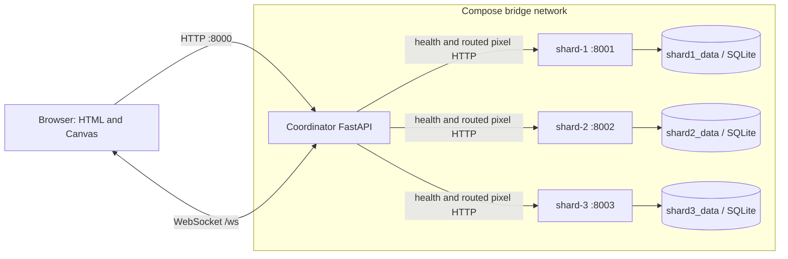

# Current Architecture

## Components and network topology

Compose defines four independent Python service processes on one host: the browser-facing coordinator and three copies of one shard application. Only coordinator port 8000 is published to the host. The services share the private `canvas-net` bridge; service DNS names and internal ports are `shard-1:8001`, `shard-2:8002`, and `shard-3:8003`. `SHARD_URLS` describes service addresses; `SHARD_IDS` separately defines the active routing set. Containers do not represent separate physical machines.

The browser never contacts shards. It loads the coordinator page, sends `/draw` and `/clear` HTTP requests, and receives `/ws` events from that same service.

## Tile coordinates and deterministic routing (Stage 3A)

`shared/tiles.py` is imported by both coordinator and shards. It validates a pixel as strict integer coordinates with `0 <= x,y < 1000`. Tile column and row are `x // 25` and `y // 25`. The row-major ordinal is `tile_y * 40 + tile_x`; the stable identifier is `tile-{row:02d}-{column:02d}`, for example `tile-00-01`.

The active shard IDs are sorted lexically. The owner is `sorted_shard_ids[tile_index % shard_count]`. This uses arithmetic, not Python's randomized `hash()`, is independent of environment-list order, and distributes 1,600 tiles across three shards as 533, 533, and 534. Example: `(25,0)` is `tile-00-01`, ordinal 1, and goes to `shard-2`; `(999,999)` has ordinal 1599 and goes to `shard-1`.

Modulo routing seeds the initial owner. The coordinator's durable tile ownership table records transfers and current epochs. Changing `SHARD_IDS` still remaps initial assignments for unregistered tiles, so keep the active shard set fixed while data matters.

## Draw, read, and Clear flow

1. The coordinator validates the HTTP session cookie and draw model. The browser cannot choose an owner ID.
2. The coordinator derives the tile, reads its current owner and epoch from SQLite, then sends `POST /pixels` only to that shard.
3. The shard recalculates the tile from `x,y`, checks the submitted tile ID and epoch, and rejects writes to a fenced or stale owner.
4. The shard commits the pixel, operation ID, and tile sequence in one SQLite transaction. A retry with the same operation ID returns the stored result. Only after a valid receipt does the coordinator update its cache, broadcast `draw`, and return success.
5. `GET /state` and a new WebSocket snapshot gather pixel rows from all active shards. A shard read failure returns an error instead of silently presenting an incomplete canvas.
6. Clear sends the server-validated user ID to all active shards. Each shard transactionally removes only its rows for that owner and returns removed coordinates. After all calls succeed, the coordinator updates its cache and broadcasts those coordinates.

Sessions persist in the coordinator's SQLite volume. Active WebSocket connections remain in memory. Each pixel row has one current color and owner; an overwrite replaces both values. The coordinator's pixel dictionary is a cache refreshed from shard databases on reads.

## Ordering and failure boundary

The coordinator holds one `asyncio.Lock` across draw shard I/O, cache mutation, and broadcasts. In the one-coordinator setup this serializes draws, clears, state snapshots, and WebSocket registration. A draw is not acknowledged or broadcast until its owner shard returns a valid commit receipt. Per-tile operation IDs, durable sequence positions, and epochs support retry deduplication and transfer fencing; multi-coordinator ordering is not implemented.

Clear spans multiple independent shard transactions. A partial failure returns 503 with partial status and refreshes connected clients from authoritative shard state when possible. Clear is blocked during a tile transfer because it is not yet part of the ordered operation log. Atomic multi-shard Clear is not claimed.

## Shard APIs and storage

Each shard runs `shard.main:create_app()` with `SHARD_ID`, `SHARD_IDS`, `PORT`, and `SHARD_DB_PATH`:

- `GET /health`: checks the shard SQLite connection and returns identity, status, and version.
- `GET /info`: reports its ID, port, database path, and service metadata.
- `POST /records`, `GET /records`, `GET /records/{record_key}`: infrastructure persistence checks.
- `POST /pixels`, `GET /pixels`, `DELETE /pixels?user_id=...`: the tile-owned pixel store.
- Tile snapshot, paged operation-log, install, import, fence, and activate routes support migration and recovery.

The coordinator's `GET /admin/shards` probes configured `/health` URLs concurrently with bounded timeouts. Health is actual HTTP health, not the source of tile ownership. The current owner is read from the coordinator's durable ownership registry.

`shard1_data`, `shard2_data`, and `shard3_data` are separate named Docker volumes, each mounted at `/data` and containing `/data/shard.sqlite3`. Normal stop/restart/recreation preserves the named volumes; `docker compose down -v` removes them. Docker runtime behavior has not been verified in this environment when the Docker CLI is absent.

## Implemented and future boundaries

Implemented behavior includes deterministic initial tile mapping, durable ownership and sessions, per-shard SQLite pixels and draw logs, operation deduplication, WebSocket broadcasts, live copying with a short fenced cutover, and automatic recovery of pending transfers. Unit tests cover routing, ordering, writes during copy, and lost responses at transfer phases. Real-container tests cover source and destination outages and coordinator restart; Chromium tests cover rendering, reconnect, and partial Clear.

Not implemented: atomic or fully ordered cross-shard Clear, persisted historical snapshots, zero-pause cutover, undo, hashes, timelapse, multiple coordinators, and cross-process WebSocket fan-out. The active shard set must remain fixed until adding/removing shards has its own safe rebalancing procedure.
