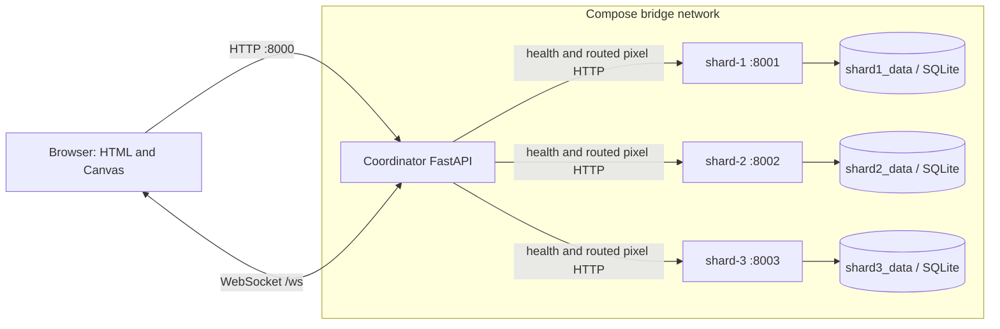

# Current Architecture

## Components and network topology

Compose defines four independent Python service processes on one host: the browser-facing coordinator and three copies of one shard application. Only coordinator port 8000 is published to the host. The services share the private `canvas-net` bridge; service DNS names and internal ports are `shard-1:8001`, `shard-2:8002`, and `shard-3:8003`. `SHARD_URLS` describes service addresses; `SHARD_IDS` separately defines the active routing set. Containers do not represent separate physical machines.

The browser never contacts shards. It loads the coordinator page, sends `/draw` and `/clear` HTTP requests, and receives `/ws` events from that same service. WebSocket snapshots and updates carry per-tile sequence positions so the browser can detect a missing update and request a fresh state by reconnecting.

## Tile coordinates and deterministic routing (Stage 3A)

`shared/tiles.py` is imported by both coordinator and shards. It validates a pixel as strict integer coordinates with `0 <= x,y < 1000`. Tile column and row are `x // 25` and `y // 25`. The row-major ordinal is `tile_y * 40 + tile_x`; the stable identifier is `tile-{row:02d}-{column:02d}`, for example `tile-00-01`.

The active shard IDs are sorted lexically. The owner is `sorted_shard_ids[tile_index % shard_count]`. This uses arithmetic, not Python's randomized `hash()`, is independent of environment-list order, and distributes 1,600 tiles across three shards as 533, 533, and 534. Example: `(25,0)` is `tile-00-01`, ordinal 1, and goes to `shard-2`; `(999,999)` has ordinal 1599 and goes to `shard-1`.

Modulo routing seeds the initial owner. The coordinator's durable tile ownership table records transfers and current epochs. Changing `SHARD_IDS` still remaps initial assignments for unregistered tiles, so keep the active shard set fixed while data matters.

## Draw, read, and Clear flow

1. The coordinator validates the HTTP session cookie and draw model. The browser cannot choose an owner ID.
2. The coordinator derives the tile, reads its current owner and epoch from SQLite, then sends `POST /pixels` only to that shard.
3. The shard recalculates the tile from `x,y`, checks the submitted tile ID and epoch, and rejects writes to a fenced or stale owner.
4. The shard commits the pixel, operation ID, and tile sequence in one SQLite transaction. A retry with the same operation ID returns the stored result. Only after a valid receipt does the coordinator update its cache, broadcast `draw`, and return success.
5. `GET /state` and a new WebSocket snapshot gather pixel rows and active tile cursors from all shards. A shard read failure returns an error instead of silently presenting an incomplete canvas. The WebSocket snapshot is sent while `canvas_lock` also prevents mutations and socket registration races.
6. Clear records a durable coordinator intent with a stable operation ID, then asks every active shard to prepare an owner-scoped coordinate list. The coordinator asks all shards to commit pixel deletion; each commit is idempotent and deletes only rows still owned by that user. After every shard commits, the coordinator moves to `finalizing`. Each shard then appends one Clear event per affected tile to `pixel_operations`, at that tile's next sequence, and marks its participant history finalized. Only after every shard finalizes does the coordinator mark the Clear complete, refresh state, and broadcast. Recovery repeats both phases safely.

Sessions persist in the coordinator's SQLite volume. Active WebSocket connections remain in memory. Each pixel row has one current color and owner; an overwrite replaces both values. The coordinator's pixel dictionary is a cache refreshed from shard databases on reads.

## Ordering and failure boundary

The coordinator holds one `asyncio.Lock` across draw shard I/O, cache mutation, broadcasts, state snapshots, and WebSocket registration. A draw is not acknowledged or broadcast until its owner shard returns a valid commit receipt. Draw events include the tile ID, ownership epoch, and durable tile sequence. Clear events include the sequence position for each changed tile. The browser keeps a cursor per tile: already-seen sequences are ignored; the next sequence is applied; a gap or backwards epoch disables drawing and reconnects for a new snapshot. The snapshot contains authoritative pixels and the corresponding durable tile positions. A failed broadcast send closes that socket so the browser resynchronizes. Transfer activation and coordinator ownership cutover are also serialized with snapshots. Multi-coordinator ordering is not implemented. Different tiles are independent, so clients detect gaps within each tile without imposing a global total order.

Clear spans multiple independent shard transactions. Its prepare intent, participant progress, and coordinate set are durable on the coordinator and shards; startup recovery retries unfinished work. Pixel deletion happens before history finalization, but replayable Clear events are not appended until all participants have committed. If history finalization itself is interrupted, the coordinator remains in a pending phase; migration/replay is blocked until recovery finishes. New draws and transfers are blocked while an intent remains unfinished. An outage can temporarily leave participants at different commit phases and the request returns an error; recovery completes later. This is not atomic across shard databases. A Clear is represented by a per-tile event with the same operation ID and initiating user, ordered at the tile's next sequence. Its WebSocket message carries those tile sequence positions. A no-op Clear remains in coordinator history but has no tile events. The legacy shard `DELETE /pixels?user_id=...` endpoint is a direct one-shard delete and bypasses this protocol; the coordinator does not use it.

## Browser resynchronization

`GET /state` returns `{pixels, positions}`. A WebSocket starts with the same `state` shape. Each shard's `/tiles/positions` endpoint reads durable tile epochs and last sequences, including a fenced source until coordinator ownership changes; the coordinator filters by its ownership registry. Untouched tiles need no entry because their initial cursor is epoch 1, sequence 0. The coordinator reads pixel rows and positions while holding `canvas_lock`, registers the socket, and sends the state before allowing subsequent mutations. Updates after that boundary arrive as ordered WebSocket events.

The page applies an event only when its sequence is the next one for that tile. It ignores repeats, and closes/reconnects when a sequence is missing or an epoch moves backwards. A reconnect paints a full snapshot, including Clear effects, then installs its cursors and reenables drawing. Missing shard data causes snapshot failure and retry; a partial canvas is not accepted. The protocol assumes one coordinator process. It does not maintain a browser event log or define an order between separate tiles.

## Snapshot restoration, hashes, and Undo

An active shard persists immutable tile checkpoints containing pixels, epoch, and last sequence. Restore resets that tile to the saved baseline and replays every later contiguous draw, Clear, and Undo event in one local SQLite transaction. A log gap aborts restore; it does not silently return partial state. Operation IDs and the current epoch/high-water sequence are retained. Checkpoints share the shard database volume and therefore survive process restarts, but not loss of that volume.

The coordinator's `GET /hash` computes SHA-256 from the merged current pixel colors using a versioned deterministic serialization: fixed header, then occupied pixels sorted by row-major tile index and local y/x, uppercase `#RRGGBB` records. It excludes owners. Equal visible canvas states therefore hash equally across shard placement. This verifies final state against an expected reference hash.

The coordinator stores each session's draw actions and prior pixel values durably, ordered within that session. `POST /undo` allows at most ten attempts for the session, deduplicated by request ID. The owning shard verifies current owner and expected color before applying a successful Undo and appends a per-tile event. If another session has overwritten that pixel, the shard records a no-effect event and leaves the newer pixel in place. Undo replays after a checkpoint like other tile operations.

These per-session action positions do not create a global canvas order. A correct chronological timelapse across independent tiles remains unimplemented. It would require a durable coordinator-wide commit journal plus retry/reconciliation for a crash between shard commit and global journal completion; the current final-state hash and replay do not need that protocol.

## Shard APIs and storage

Each shard runs `shard.main:create_app()` with `SHARD_ID`, `SHARD_IDS`, `PORT`, and `SHARD_DB_PATH`:

- `GET /health`: checks the shard SQLite connection and returns identity, status, and version.
- `GET /info`: reports its ID, port, database path, and service metadata.
- `POST /records`, `GET /records`, `GET /records/{record_key}`: infrastructure persistence checks.
- `POST /pixels`, `GET /pixels`, `DELETE /pixels?user_id=...`: the tile-owned pixel store.
- `POST /clear/{operation_id}/prepare`, `/commit`, and `/finalize`: durable participant side of coordinator Clear recovery and per-tile history finalization.
- `GET /tiles/positions` returns durable tile epochs and last sequences for browser snapshots.
- `POST /tiles/{tile_id}/snapshots` persists a checkpoint; `POST /tiles/{tile_id}/snapshots/{snapshot_id}/restore` restores it and replays later operations.
- Tile snapshot, paged operation-log, install, import, fence, and activate routes support migration and recovery.

The coordinator's `GET /admin/shards` probes configured `/health` URLs concurrently with bounded timeouts. Health is actual HTTP health, not the source of tile ownership. The current owner is read from the coordinator's durable ownership registry.

Coordinator browser-facing routes include `POST /undo` for bounded, owner-checked user undo and `GET /hash` for the merged visible canvas hash.

`shard1_data`, `shard2_data`, and `shard3_data` are separate named Docker volumes, each mounted at `/data` and containing `/data/shard.sqlite3`. Normal stop/restart/recreation preserves the named volumes; `docker compose down -v` removes them. Docker runtime behavior has not been verified in this environment when the Docker CLI is absent.

## Implemented and future boundaries

Implemented behavior includes deterministic initial tile mapping, durable ownership and sessions, per-shard SQLite pixels and per-tile draw/Clear logs, operation deduplication, per-tile WebSocket gap detection and snapshot resynchronization, live copying with a short fenced cutover, automatic recovery of pending transfers and Clears, and snapshot-plus-log replay for migration. Local tests cover reconnect snapshots, cursor ordering, partial Clear recovery followed by replay into restored tile snapshots, and snapshots serialized against mutations; live browser/Docker behavior must be verified with the opt-in integration tests.

Not implemented: atomic cross-shard Clear, a total order across independent tiles, browser replay from a historical event stream, chronological timelapse/reference frame generation, zero-pause cutover, multiple coordinators, and cross-process WebSocket fan-out. Reconnect restores current state rather than replaying missed messages. Tile restore and migration replay support draw, Clear, and Undo history; the final visible state can be compared with the deterministic `/hash` output. The active shard set must remain fixed until adding/removing shards has its own safe rebalancing procedure.
