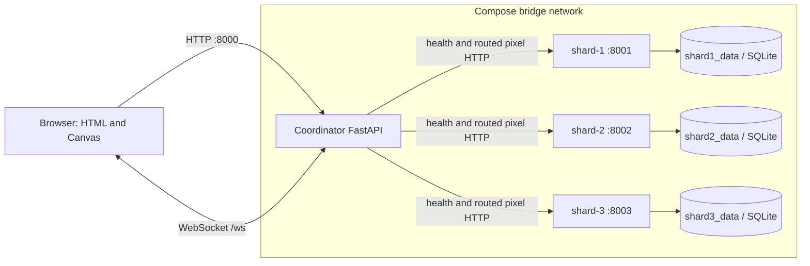

# Current Architecture

## Components and network topology

Compose defines four independent Python service processes on one host: the browser-facing coordinator and three copies of one shard application. Only coordinator port 8000 is published to the host. The services share the private `canvas-net` bridge; service DNS names and internal ports are `shard-1:8001`, `shard-2:8002`, and `shard-3:8003`. `SHARD_URLS` describes service addresses; `SHARD_IDS` separately defines the active routing set. Containers do not represent separate physical machines.

The browser never contacts shards. It loads the coordinator page, sends `/draw` and `/clear` HTTP requests, and receives `/ws` events from that same service.

## Tile coordinates and deterministic routing (Stage 3A)

`shared/tiles.py` is imported by both coordinator and shards. It validates a pixel as strict integer coordinates with `0 <= x,y < 1000`. Tile column and row are `x // 25` and `y // 25`. The row-major ordinal is `tile_y * 40 + tile_x`; the stable identifier is `tile-{row:02d}-{column:02d}`, for example `tile-00-01`.

The active shard IDs are sorted lexically. The owner is `sorted_shard_ids[tile_index % shard_count]`. This uses arithmetic, not Python's randomized `hash()`, is independent of environment-list order, and distributes 1,600 tiles across three shards as 533, 533, and 534. Example: `(25,0)` is `tile-00-01`, ordinal 1, and goes to `shard-2`; `(999,999)` has ordinal 1599 and goes to `shard-1`.

This simple modulo choice is deterministic for a fixed shard set, but changing `SHARD_IDS` remaps many tiles. Do not add a shard to the active routing list while existing data matters; Stage 3D migration is not implemented.

## Draw, read, and Clear flow

1. The coordinator validates the HTTP session cookie and draw model. The browser cannot choose an owner ID.
2. The coordinator derives the tile and owner using `shared.tiles`, then sends `POST /pixels` only to that shard.
3. The shard recalculates the tile from `x,y`, checks the submitted tile ID, and independently verifies that the configured deterministic owner is itself.
4. The shard upserts one SQLite row `(x, y, tile_id, color, owner)` in a transaction. On success it returns a commit receipt. Only after validating that receipt does the coordinator update its cache, broadcast `draw`, and return success to the browser.
5. `GET /state` and a new WebSocket snapshot gather pixel rows from all active shards. A shard read failure returns an error instead of silently presenting an incomplete canvas.
6. Clear sends the server-validated user ID to all active shards. Each shard transactionally removes only its rows for that owner and returns removed coordinates. After all calls succeed, the coordinator updates its cache and broadcasts those coordinates.

The session map remains coordinator memory. Each pixel row has one current color and owner; an overwrite replaces both values. The coordinator's pixel dictionary is only a cache refreshed from the shard databases on reads.

## Ordering and failure boundary

The coordinator holds one `asyncio.Lock` across shard I/O, cache mutation, and broadcasts. In the one-coordinator setup this serializes draws, clears, state snapshots, and WebSocket registration. A draw is not acknowledged or broadcast until its owner shard returns a valid commit receipt. No operation IDs, durable positions, or epochs exist yet, so retry deduplication and multi-coordinator ordering are not guaranteed.

Clear spans multiple independent shard transactions. Its broadcast and success response occur only after all shard responses succeed, but without a distributed transaction a shard/network failure mid-clear can leave partial deletions. The route returns an error and does not broadcast in that case; a later state read reloads the actual stored rows. Atomic multi-shard Clear is not claimed.

## Shard APIs and storage

Each shard runs `shard.main:create_app()` with `SHARD_ID`, `SHARD_IDS`, `PORT`, and `SHARD_DB_PATH`:

- `GET /health`: checks the shard SQLite connection and returns identity, status, and version.
- `GET /info`: reports its ID, port, database path, and service metadata.
- `POST /records`, `GET /records`, `GET /records/{record_key}`: infrastructure persistence checks.
- `POST /pixels`, `GET /pixels`, `DELETE /pixels?user_id=...`: the Stage 3A tile-owned pixel store.

The coordinator's `GET /admin/shards` probes configured `/health` URLs concurrently with bounded timeouts. Health is actual HTTP health, not the source of tile ownership. The route's active owner is computed locally from the explicit shard ID list.

`shard1_data`, `shard2_data`, and `shard3_data` are separate named Docker volumes, each mounted at `/data` and containing `/data/shard.sqlite3`. Normal stop/restart/recreation preserves the named volumes; `docker compose down -v` removes them. Docker runtime behavior has not been verified in this environment when the Docker CLI is absent.

## Implemented and future boundaries

Implemented source behavior includes deterministic tile mapping, fixed-set shard assignment, coordinator routing, shard-side ownership validation, per-shard SQLite pixel persistence, existing server-managed pixel owner/Clear behavior, and WebSocket broadcasts after a shard commit. Local unit tests cover coordinate boundaries, assignment, shard rejection, routing, and ownership. The opt-in real-container integration test exercises two browser sessions, persisted shard reads, coordinator state refresh, rejection by a non-owner shard, and WebSocket snapshots/updates against the running Compose services. A successful run requires the Docker daemon and Compose project to be accessible to pytest.

Not implemented: mutable ownership records, epochs, stale-epoch checks, operation IDs/deduplication, per-tile durable sequence positions, cross-shard atomic Clear, live migration, recovery, undo, hashes, timelapse, multiple coordinators, and cross-process WebSocket fan-out. Run the Docker-backed integration test in an environment with Docker daemon access to establish actual inter-container routing and persistence.
