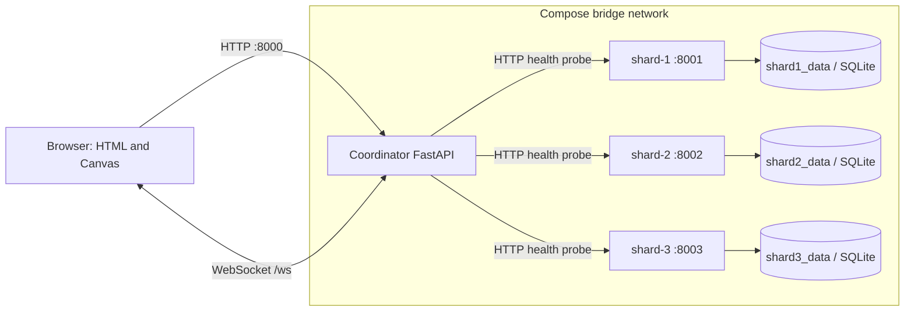

# Current Architecture

## Components and network topology

Docker Compose describes four independent Python service processes on one host: the existing coordinator plus three copies of one shard application. Only coordinator port 8000 is published to the host. Services share the private `canvas-net` bridge; the coordinator discovers shard health at service DNS addresses `shard-1:8001`, `shard-2:8002`, and `shard-3:8003`. `SHARD_URLS` can add configured fixed services, including shard-4 after its Compose service is declared.

The browser never contacts shard services. It loads the existing page from the coordinator and uses that same host for drawing/clear HTTP requests and `/ws` updates.

## Coordinator responsibilities and pixel flow

The coordinator serves `GET /`, `GET /state`, `POST /draw`, `DELETE /clear`, and `WS /ws`. It issues an HTTP-only SameSite=Lax cookie and maps its opaque token to a server-side session ID. The session map and the canvas dictionary are process-local.

Each `pixels` entry is keyed by a coordinate string such as `12,12` and holds one `{color, owner}` record. A draw derives the owner from the validated session cookie and replaces the complete record. A clear deletes only records whose current owner equals that session's ID. A later writer therefore takes over ownership of a coordinate and protects it from the former owner's clear.

One `asyncio.Lock` serializes `/state` snapshots, draws, clears, WebSocket connection registration, initial snapshots, and event broadcasts. Within the one coordinator process, a new socket receives a snapshot before subsequent mutation events; concurrent draw and clear operations are applied and broadcast in lock-acquisition order. The lock is held during WebSocket sends, so a slow client can delay other canvas operations.

## Shard responsibilities and health flow

Each shard runs `shard.main:create_app()` with its own `SHARD_ID`, `PORT`, and `SHARD_DB_PATH`. It exposes:

- `GET /health`: opens the shard DB and performs a `SELECT 1`, returning the shard ID, status, database connectivity, and version.
- `GET /info`: reports identity, internal port, database path, and service metadata.
- `POST /records`, `GET /records`, and `GET /records/{record_key}`: parameterized SQLite infrastructure checks. These are not drawing-operation routes.

The coordinator's `GET /admin/shards` concurrently probes each configured `/health` URL with bounded timeouts. Healthy, unhealthy, and unavailable nodes get per-shard results; a network failure does not fail the coordinator endpoint.

## Persistence and failure boundaries

`shard1_data`, `shard2_data`, and `shard3_data` are separate named Docker volumes. Each is mounted at `/data` and contains that container's `/data/shard.sqlite3`. Normal stop, restart, and container recreation preserve named volumes. `docker compose down -v` removes them.

These SQLite tables store only sample infrastructure records. Canvas pixels, user sessions, and WebSocket connections are not persisted or shared between coordinator replicas. There is no tile routing, shard ownership, operation log, ownership epoch, migration state machine, or crash-recovery protocol yet. The coordinator remains a single point of failure, and all containers run on one physical Docker host.

## Test boundary

`tests/test_canvas.py` tests coordinator ownership and synchronization using FastAPI TestClient and deterministic fake sockets. `tests/test_infrastructure.py` tests shard apps locally and mocks coordinator probe results. `tests/integration/test_docker_services.py` is a separate opt-in test that uses `docker compose exec`, inspects actual Docker volume mounts, and restarts a real container. Unit success does not prove the integration test or Docker runtime works.

## Next phases

Phase 3 can add deterministic tile mapping and route operations to shard owners. Ownership epochs, per-tile positions, operation deduplication, live migration, durable canvas history/recovery, undo, and timelapse remain later planned features and are not part of this architecture's current implementation.
