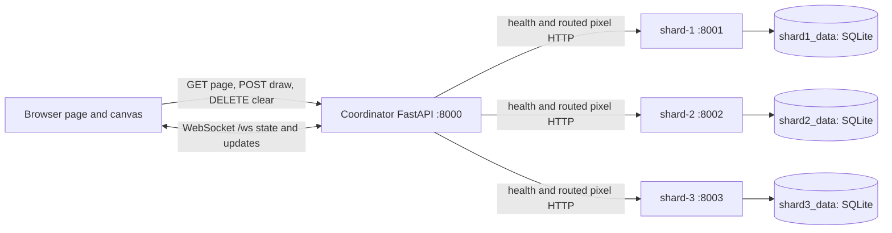

# Follow Along: Collaborative Pixel Canvas

This guide describes the repository as it exists today. It is a learning companion to the short [README](README.md), not a claim that every goal in the course proposal is already implemented.

## A. Project overview

The browser shows a 1000 by 1000 HTML canvas. A browser session can choose a colour and draw at a coordinate. Other browsers connected to the same coordinator see committed draw and clear messages over a WebSocket.

The project currently demonstrates several useful distributed-systems building blocks:

- **Identity and ownership:** the coordinator issues an opaque browser cookie and maps it to a server-side session ID. Every occupied coordinate stores its current colour and the session that last drew it.
- **Concurrent updates:** one `asyncio.Lock` serializes canvas reads, draws, clears, WebSocket registration, initial snapshots, and broadcasts inside the coordinator process.
- **Service separation:** Docker Compose describes a coordinator and three independently configured shard services, connected by a bridge network and DNS names.
- **Deterministic tile routing:** a shared routing module maps each pixel to a row-major tile and assigns each tile to one configured shard without Python's randomized `hash()`.
- **Shard-owned pixel records:** the coordinator sends each draw to its selected shard. That shard verifies tile ownership and writes the pixel's colour and session owner into SQLite.
- **Recoverable, ordered Clear:** a UUID operation ID and durable prepare/commit/finalize records let the coordinator resume interrupted cross-shard Clear after restart. Once every participant commits deletion, shards add Clear events to affected tiles' ordered operation logs.
- **Browser resynchronization:** live draw/Clear events carry durable per-tile sequence positions. The browser ignores duplicates and reconnects for an authoritative snapshot if it sees a sequence gap.
- **Snapshot replay and verification:** shards can store a durable per-tile checkpoint, restore it, and replay later draw, Clear, and Undo log entries. `/hash` computes a canonical SHA-256 over visible canvas colors.
- **User-aware undo:** each session can attempt to undo its latest draw up to ten times. Undo only restores the prior pixel if that session still owns the current value; another user's overwrite is preserved.
- **Storage isolation:** each shard service has a distinct SQLite file in its own named Docker volume. The same DB also contains sample infrastructure records.

The browser talks to the coordinator only. It accepts draw, Undo, and Clear HTTP requests, routes tile operations to shards, and sends WebSocket updates only after the assigned shard confirms them. Clear uses durable coordinator and shard prepare/commit/finalize records. Session mappings and a coordinator pixel cache are held in process memory, while session identity, ownership, per-session undo attempts, and draw action order are stored in coordinator SQLite. Docker source/configuration exists, but live container verification must be established on a machine with Docker.

Docker containers simulate distinct processes and service identities on one physical computer. A Compose network gives each service a DNS name, and named volumes keep each shard database across container restarts. This is a useful local distributed-systems lab, but it is not a simulation of separate physical computers or networks with independent failures.

## B. Prerequisites and setup

### Recoverable cross-shard Clear (Priority 1)

The Clear button sends a browser-generated UUID in `X-Operation-ID` and retains it while the page remains open if the request fails, so another click retries the same operation. Coordinator SQLite records the user, participants, phase, coordinates, and history-finalization status. Each shard's `clear_operations` table records its prepared coordinate set and commit/finalize phase in the same SQLite database as its pixels. After all pixel commits, each shard writes one Clear event per affected tile into `pixel_operations` at that tile's next sequence. The coordinator marks Clear complete only after every shard finalizes its history event. A shard process restart with its named volume intact retains both records; deleting the volume or losing its database is not recoverable. A failure may temporarily leave participants at different phases, but draws and migration wait while recovery retries. This remains recoverable, not atomic.

Tile Clear events carry the Clear operation ID and initiating session ID. They use the existing per-tile sequence, so a draw before Clear has a lower sequence and a draw after Clear has a higher sequence on that tile. The coordinator's pending phase is the global completion marker: migration's snapshot/import replay path is blocked until all participants have finalized. A no-op Clear has no tile event, but its completed coordinator record remains durable.

Completed Clears from before ordered Clear history was added remain in the coordinator's legacy records, but their exact position relative to older draws cannot be reconstructed; migration marks them complete without fabricating a tile sequence.

### Browser disconnect and resynchronization (Priority 2)

The WebSocket's first `state` message contains the complete current pixel map and a `positions` map keyed by tile ID. A position contains the tile ownership `epoch` and last committed `sequence`. Draw messages carry one tile position; Clear messages carry one position per affected tile. The page applies only the next sequence for each tile, ignores repeats, and closes/reconnects if it sees a gap or an invalid/backwards position. The reconnect paints a fresh state before reenabling drawing. If a shard cannot answer, the page remains disabled and retries instead of treating partial pixels as complete.

### Undo, durable tile snapshots, replay, and hashes

The coordinator records each session's successful draws and their previous pixel values. **Undo last draw** targets that session's most recent draw that has not already had an undo attempt. A successful undo restores the previous owner and color, or deletes the pixel if it was empty before the draw. If another session has overwritten the pixel, undo is recorded as skipped and leaves the newer pixel alone. Each session has at most ten undo attempts; reusing an `X-Operation-ID` retries the same attempt without consuming another slot. The shard logs both successful and skipped Undo events at the tile's next sequence, so migration and replay preserve their result.

An active shard creates a durable checkpoint with `POST /tiles/{tile_id}/snapshots`. The response includes a snapshot ID, owner epoch, last tile sequence, and pixel count. `POST /tiles/{tile_id}/snapshots/{snapshot_id}/restore` installs that checkpoint's pixels and replays all later operations in sequence, including Clear and Undo. Restore fails rather than committing partial data if the log has a gap. A saved checkpoint lives in the same named shard volume as its operation log; losing that volume loses both. These are per-tile checkpoints, not a cross-shard snapshot catalog.

`GET /hash` returns SHA-256 over visible pixel colors. Serialization includes a fixed canvas/version header, then occupied pixels in row-major tile order and local y/x order. Each line contains the tile index, local y, local x, and uppercase `#RRGGBB`. Ownership is excluded, so the same visible canvas hashes equally after migration to different shards. A hash verifies final state; it does not prove a chronological timelapse.

To verify snapshot replay in PowerShell with Compose running, draw red at `(25,0)`, save a shard-2 checkpoint, draw blue, restore the checkpoint, and compare the hash before and after restore:

```powershell
$webSession = New-Object Microsoft.PowerShell.Commands.WebRequestSession
Invoke-WebRequest http://localhost:8000/ -WebSession $webSession | Out-Null
$drawRed = @{ x = 25; y = 0; color = "#ff0000" } | ConvertTo-Json
Invoke-RestMethod http://localhost:8000/draw -Method Post -ContentType "application/json" -Body $drawRed -WebSession $webSession | Out-Null
$snapshot = docker compose exec shard-2 python -c "import json,urllib.request; r=urllib.request.Request('http://127.0.0.1:8002/tiles/tile-00-01/snapshots',data=b'',method='POST'); print(urllib.request.urlopen(r).read().decode())" | ConvertFrom-Json
$drawBlue = @{ x = 25; y = 0; color = "#0000ff" } | ConvertTo-Json
Invoke-RestMethod http://localhost:8000/draw -Method Post -ContentType "application/json" -Body $drawBlue -WebSession $webSession | Out-Null
$expectedHash = (Invoke-RestMethod http://localhost:8000/hash).hash
$snapshotId = $snapshot.snapshot_id
docker compose exec shard-2 python -c "import urllib.request; sid='$snapshotId'; u='http://127.0.0.1:8002/tiles/tile-00-01/snapshots/'+sid+'/restore'; r=urllib.request.Request(u,data=b'',method='POST'); print(urllib.request.urlopen(r).read().decode())"
$restoredHash = (Invoke-RestMethod http://localhost:8000/hash).hash
$expectedHash -eq $restoredHash
```

The final PowerShell expression should print `True`; the restore response should report `status: restored` and the same last sequence as before restore. Shard 2 is the configured owner of tile `tile-00-01`. `docker compose exec` uses the container's internal port; Windows only publishes coordinator port `8000`.

To verify the Undo button manually, draw a pixel twice with one session and click **Undo last draw** once; it should restore the first color. Then overwrite the pixel from another browser profile and click Undo in the original profile; the response reports a skipped undo and the newer color stays. The UI reports attempts used out of ten; an eleventh new attempt receives HTTP 429.

To verify missed-update recovery in two browser tabs, open the canvas in both tabs using the same browser profile. In the first tab, open Developer Tools, select **Network**, and enable **Offline**. In the second tab, draw a pixel. Restore the first tab's network connection. It should briefly show **Disconnected — reconnecting...**, then return to **Connected — live collaboration enabled** with the missed pixel visible. Draw again and confirm both tabs update. A repeated event is ignored using its per-tile sequence; a skipped sequence triggers reconnect and an authoritative redraw.

To verify Clear recovery, draw a pixel in one tab, take that tab offline, and use the second tab in the same browser profile to click **Clear my pixels** (both tabs share the session cookie). Restore the first tab's connection. The pixel should remain white after it resynchronizes. For coordinator restart recovery, leave a drawn pixel visible and run these commands in PowerShell from the repository root:

```powershell
docker compose ps
docker compose restart coordinator
docker compose logs --tail 100 coordinator
```

The browser should disable drawing while disconnected, reconnect after the coordinator is healthy, and redraw committed state from shard SQLite. `docker compose restart` preserves `coordinator_data`, `shard1_data`, `shard2_data`, and `shard3_data`; do not use `docker compose down -v` for this check. Only coordinator port `8000` is published to Windows; shard ports `8001`–`8003` are internal to the Compose network. To inspect status and follow reconnect logs:

```powershell
docker compose ps
docker compose logs --tail 100 -f coordinator
```

Press Ctrl+C to stop following logs. `docker compose stop coordinator` followed by `docker compose start coordinator` also simulates an outage without removing volumes.

`GET /tiles/{tile_id}/snapshot` returns a point-in-time pixel state and its last tile sequence. Migration installs that snapshot as destination state, then imports later operations. The importer now applies Clear events as well as draws. This provides deterministic replay within each tile; there is still no public full-canvas replay endpoint, global total order across different tiles, or long-term snapshot catalog.

Files changed for this stage: `frontend/main.py` coordinates durable intent, retry, recovery, and history finalization; `shard/main.py` implements prepare/commit/finalize and Clear-aware snapshot replay; `frontend/index.html` preserves the request ID between retries; `tests/test_canvas.py` covers coordinator recovery and partial-Clear replay; `tests/test_ordered_operations.py` covers shard restart, sequence ordering, duplicate finalization, and snapshot restoration; the project docs record the protocol and limits.

To build and start services after pulling or editing these files, run in PowerShell:

```powershell
docker compose up --build -d
docker compose ps
docker compose logs --tail 100 coordinator shard-1 shard-2 shard-3
```

The compose command rebuilds changed images and recreates the coordinator and shard processes. Ports remain coordinator `8000` on the host and shard ports `8001`–`8003` only inside `canvas-net`. Coordinator state (including Clear intents and history-finalization status) persists in `coordinator_data`; each shard's pixels, per-tile draw/Clear history, snapshots installed by migration, and participant records persist in its own `shard*_data` volume.

To verify a Clear interrupted by a shard outage without deleting data:

1. Open `http://localhost:8000/`, draw one or more pixels, then run `docker compose stop shard-2` in PowerShell.
2. Click **Clear my pixels**. The request returns an incomplete message and retains its operation ID in that page. The coordinator records the intent and retries it in the background.
3. Simulate a coordinator restart while the shard is still stopped with `docker compose restart coordinator`. The coordinator's pending intent remains in `coordinator_data`; recovery continues to retry.
4. Restore the shard with `docker compose start shard-2`. Inspect recovery using `docker compose logs --tail 100 coordinator` and health using `Invoke-RestMethod http://localhost:8000/admin/shards`.
5. Wait for the browser WebSocket to reconnect. The recovered operation publishes a refreshed state to connected clients. Clicking Clear again in the original page retries with the same ID; a repeated completed request does not clear a later draw.

`docker compose restart shard-2` also safely restarts the shard while retaining its volume. `docker compose down` removes containers but preserves named data volumes. Do not use `docker compose down -v` for routine cleanup; it deletes those volumes and their databases.

Open two browser windows at `http://localhost:8000/`, draw separate pixels, and clear one session. Its own pixels disappear while the other user's pixels remain. For focused tests, install development dependencies with `python -m pip install -r requirements-dev.txt`, then run `python -m pytest -q tests/test_canvas.py tests/test_ordered_operations.py`. For real service coverage, start Compose and run these PowerShell commands:

```powershell
$env:RUN_DOCKER_INTEGRATION = "1"
python -m pytest -q tests/integration
Remove-Item Env:RUN_DOCKER_INTEGRATION
```

Browser integration is opt-in and must use a disposable Compose project as described in README.

### Known versions and prerequisites

- Windows 11 development environment.
- Python 3.11 or later is the documented minimum; the original development machine used Python 3.12.4.
- Docker Desktop for Windows using Linux containers and its WSL 2 backend; Docker Compose v2 is used by the commands below. Versions are not pinned in the repository.
- A modern browser and VS Code are useful.
- Package versions in `requirements.txt` are not pinned. Install them into a virtual environment for local Python work.

For official setup details, see [Microsoft's WSL installation guide](https://learn.microsoft.com/en-us/windows/wsl/install) and [Docker Desktop's WSL 2 backend instructions](https://docs.docker.com/desktop/features/wsl/).

### Windows 11: WSL 2 and Docker Desktop

In an elevated PowerShell terminal if Windows asks for administrator permission:

```powershell
wsl --install
wsl --update
wsl --status
```

Restart Windows if prompted. Install and start Docker Desktop. In Docker Desktop, select **Settings → General → Use the WSL 2 based engine**, then **Apply**. If you also use a Linux distribution terminal, enable it under **Settings → Resources → WSL Integration**. Docker Desktop can also be used from PowerShell without installing a separate Linux distribution. Confirm the engine is available:

```powershell
docker version
docker compose version
```

The application images use Linux containers. If Docker commands are not found, install/start Docker Desktop and reopen the terminal. If the CLI exists but reports a daemon error, wait for Docker Desktop's engine to start.

### Python environment for tests or local coordinator work

Run these commands from the project root, the directory containing `requirements.txt`:

```powershell
py --version
py -m venv .venv
.\.venv\Scripts\Activate.ps1
python -m pip install -r requirements.txt
```

If PowerShell blocks activation, invoke the virtual environment interpreter directly or use Command Prompt's `.venv\Scripts\activate.bat`. The dependency list currently includes FastAPI, Uvicorn, HTTPX, pytest, and pytest-asyncio.

### Start the Docker system

Still in the project root:

```powershell
Copy-Item .env.example .env
docker compose up --build
```

The coordinator is published on host port 8000:

- Canvas: <http://localhost:8000/>
- FastAPI docs: <http://localhost:8000/docs>
- Coordinator health: <http://localhost:8000/health>
- Live shard health overview: <http://localhost:8000/admin/shards>

The `.env` file sets `SHARD_URLS` and `SHARD_IDS`. The coordinator uses entries such as `shard-1=http://shard-1:8001`; Docker DNS resolves those service names inside `canvas-net`. `SHARD_IDS` defines the active route set. Shard ports are not published to Windows.

Useful lifecycle and inspection commands:

```powershell
docker compose ps
docker compose logs -f coordinator
docker compose logs -f shard-1
docker compose stop shard-2
docker compose start shard-2
docker compose restart shard-1
docker compose down
```

`docker compose down` keeps the three named data volumes. `docker compose down -v` deletes them and their records; reserve it for an intentional data reset. The test guide below does not delete volumes.

### Run tests

Local unit and API tests (the Docker integration test is skipped unless explicitly enabled):

```powershell
python -m pytest -q tests -p no:cacheprovider
```

Start the Compose services in one terminal. In another terminal, from the project root, run the real-container test:

```powershell
$env:RUN_DOCKER_INTEGRATION = "1"
python -m pytest -q tests/integration -p no:cacheprovider
Remove-Item Env:RUN_DOCKER_INTEGRATION
```

The integration test calls the host coordinator, runs HTTP requests inside actual shard containers with `docker compose exec`, inspects their mounted volume names, restarts shard-1, and checks that its record remains. It requires a running project. A skipped integration test is not evidence that Docker works.

## C. Architecture and data flow



### Browser to coordinator

1. `GET /` serves `frontend/index.html` and issues the `canvas_session` cookie if this browser has no registered session. The cookie is HTTP-only and SameSite=Lax; Secure is unset because the documented local service uses plain HTTP.
2. The browser opens `/ws` on the same host. The coordinator accepts only a token already present in its session registry.
3. The coordinator sends one initial `state` message. The page renders that message, then applies later `draw` and `clear` messages.
4. A pointer click posts `x`, `y`, and a HEX colour to `/draw`. The server gets the owner from the cookie, not from request JSON.
5. `DELETE /clear` removes only records currently owned by that session.

### Tile calculation and shard assignment

`shared/tiles.py` is copied into both images and imported by both coordinator and shards. It accepts only real integer coordinates (not booleans or fractional numbers) within the 1000×1000 grid. For pixel `(x,y)`, `tile_x=x//25`, `tile_y=y//25`, and `tile_index=tile_y*40+tile_x`. The ID format is `tile-{row:02d}-{column:02d}`: `(25,0)` is `tile-00-01`, and `(999,999)` is `tile-39-39`.

`SHARD_IDS` is sorted lexically, then `tile_index % number_of_shards` selects one owner. With three default shards, tile index 0 routes to shard-1, index 1 to shard-2, index 2 to shard-3, and index 3 returns to shard-1. All 1,600 tiles are assigned once; counts are 533, 533, and 534. Reordering `SHARD_IDS` has no effect. Changing the set does: modulo can remap many tiles, and there is no migration yet, so do not change active IDs while data matters.

### Pixel ownership and synchronization

The coordinator obtains a session owner from the HTTP-only cookie, never a browser-supplied `user_id`. A draw includes `x`, `y`, calculated `tile_id`, normalized colour, and that session owner in an internal request. The target shard recalculates the tile, verifies the ID and verifies that the routing algorithm selects itself. A wrong tile ID gets 422; a tile assigned elsewhere gets 409.

Each shard stores one row keyed by `(x,y)` with both colour and owner in one SQLite upsert. This preserves the most recent writer as current owner. The coordinator waits for the owning shard's committed response, checks its shard ID/tile/colour/owner receipt, then updates its in-memory cache and broadcasts. A failure or invalid receipt produces an error and is not broadcast.

`GET /state` and new WebSocket snapshots combine records from all active shards; state reads fail instead of returning a silently incomplete canvas when a shard is unavailable. `DELETE /clear` prepares owner-scoped coordinates on every shard, commits pixel deletion, then finalizes per-tile Clear history after all participants commit. It broadcasts only after the coordinator marks the full operation complete. A failure can leave partial pixel deletion while recovery is pending; there is no distributed transaction across shards.

One `asyncio.Lock` covers coordinator state reads, shard operations, cache updates, WebSocket registration/snapshots, and broadcasts. In a single coordinator process it orders a draw and a clear and prevents a snapshot from racing with a write. It is not a guarantee across multiple coordinator processes.

### Coordinator to shards and SQLite

Compose places all four services on `canvas-net`. The coordinator checks configured URLs such as `http://shard-1:8001/health`; each shard checks its own SQLite connection and returns its configured ID and service version. `/admin/shards` makes the probes concurrently with short timeouts and returns per-shard health, including unavailable nodes.

Each shard has `infrastructure_records`, `pixels`, `tile_ownership`, `pixel_operations`, `clear_operations`, and `tile_snapshots` tables in its own `/data/shard.sqlite3`. `POST /pixels` validates the tile's current local epoch before committing the pixel and ordered draw log; `POST /undo` appends a conditional Undo event; Clear `prepare`, `commit`, and `finalize` routes persist participant work and ordered history. Snapshot restore replays later draw, Clear, and Undo events. `DELETE /pixels?user_id=...` remains a legacy one-shard endpoint and bypasses coordinator Clear recovery. `shard1_data`, `shard2_data`, and `shard3_data` are separate Docker-managed named volumes mounted at `/data`; the shard's current records, snapshots, and operation tables survive process restarts while those volumes remain intact.

## D. File-by-file guide

| File | Responsibility and relationships |
|---|---|
| `frontend/main.py` | Coordinator app, HTTP routes, cookie sessions, durable user action/Undo bookkeeping, current pixel ownership, WebSocket manager, final-state hashing, and shard health probes. Serves `index.html`. |
| `frontend/index.html` | Browser UI, Canvas drawing, draw/undo/clear requests, WebSocket state/update rendering. |
| `shared/tiles.py` | Shared strict coordinate validation, stable row-major tile IDs, canonical shard ID configuration, and deterministic owner selection. Both coordinator and shard import it. |
| `shared/__init__.py` | Marks `shared` as an importable package so both images can load the same routing code. |
| `shard/main.py` | Factory for the common shard FastAPI app, SQLite setup, durable tile snapshots, draw/Clear/Undo logs, replay, and pixel ownership APIs. Compose starts this same module three times. |
| `shard/__init__.py` | Marks `shard` as an importable Python package for Uvicorn and tests. |
| `docker/coordinator.Dockerfile` | Builds the coordinator image with Python dependencies and `frontend/`; starts Uvicorn on port 8000. |
| `docker/shard.Dockerfile` | Builds the common shard image and starts Uvicorn on the environment-provided internal port. |
| `docker-compose.yml` | Defines coordinator, three shard services, health checks, restart policies, private bridge network, published coordinator port, and separate named volumes. |
| `.env.example` | Template for `SHARD_URLS` (service addresses) and `SHARD_IDS` (active tile-routing set); copy to `.env`. |
| `.dockerignore` | Keeps local virtual environments, tests, caches, databases, and secrets out of image build contexts. |
| `.gitignore` | Excludes local environments, database files, cache output, and `.env` from normal version control. |
| `requirements.txt` | Runtime and test dependencies, including the synchronous WebSocket client used by the real-container integration test. |
| `pytest.ini` | Registers the `integration` pytest marker. |
| `tests/test_canvas.py` | Session, ownership/Clear, validation, WebSocket ordering, and lock interleaving regressions. |
| `tests/test_infrastructure.py` | Local shard API and mocked coordinator health/discovery tests. It does not start containers. |
| `tests/test_tiles.py` | Pure tests for coordinate boundaries, stable tile IDs, deterministic assignment, and shard balance. |
| `tests/integration/test_docker_services.py` | Opt-in test that uses a live Compose project and real shard containers. |
| `README.md` | Short setup, command, and troubleshooting entry point linking here. |
| `ARCHITECTURE.md` | Concise system boundary, network, health, storage, and Phase 3 scope description. |
| `decision.md` | Chronological architecture decision records, including proposals not yet implemented. |
| `document.pdf`, `collab pixel doc.pdf` | Course proposal/reference documents describing intended future distributed behavior. Proposal content is not proof of implementation. |
| `frontend/__pycache__/*`, `tests/__pycache__/*` | Generated Python bytecode artifacts. They are not source-of-truth files and should not be hand-edited. |
| `.gitattributes` | Requests Git's standard text-file line-ending normalization. |

## E. Function-by-function guide

### `frontend/main.py`

**`ConnectionManager.__init__(self)`** initializes `active_connections`, the in-process list of connected WebSocket objects. It returns `None` and does not touch the canvas. `manager` is the one coordinator instance.

**`ConnectionManager.disconnect(self, websocket)`** removes the given socket if present. It returns `None`; it is idempotent for an already-removed socket. `websocket_endpoint` calls it in `finally`, and `broadcast` calls it after a failed send. It does not change pixel state.

**`ConnectionManager.broadcast(self, message)`** sends a JSON event to a copy of `active_connections`. It returns `None`; a failed send is logged and that connection is removed. Draw/clear call it while holding `canvas_lock`, so messages follow mutation order in this process. A slow socket can hold up other operations because sends are sequential and no send timeout is configured.

**`session_for(token)`** accepts a cookie token or `None`; it returns `(token, user_id)`. A registered token reuses its existing ID. Any missing/unknown token causes a random URL-safe token and UUID session ID to be generated and saved in the server dictionary. It never trusts an ID in a request body. The registry is in memory, has no expiration/authentication, and resets on coordinator restart.

**`public_pixels()`** takes no arguments and returns a new coordinate-to-colour dictionary from the coordinator cache, omitting owner metadata. `GET /state` and the WebSocket snapshot call it after reloading the cache from shards while holding `canvas_lock`.

**`configured_shards()`** takes no arguments and returns `list[tuple[shard_id, base_url]]`, parsed from `SHARD_URLS`. If it is unset or blank, it uses the three Compose service-name defaults. Malformed entries raise `ValueError`. Both health discovery and internal URL lookup use it.

**`shard_urls_by_id()`** takes no arguments and returns a dictionary from shard ID to base URL. It checks that every active `SHARD_IDS` routing owner has a URL, while allowing extra health-only services. A mismatch raises `ValueError` before a draw can be sent to an ambiguous destination.

**`request_shard(shard_id, method, path, *, params=None, body=None)`** sends one bounded HTTPX request to the explicitly named shard URL. It returns a JSON object. HTTP rejections become `ShardRequestError` with 502; network, timeout, or invalid JSON failures become 503. Draw, Clear, and state loading call it. It never retries or selects a different shard.

**`load_pixels_from_shards()`** takes no arguments and concurrently requests `/pixels` from each active shard. It returns a coordinate-keyed dictionary containing internal color and owner fields. It is used by `/state` and WebSocket setup. Any request failure prevents an incomplete combined state from being returned.

**`inspect_shard(shard_id, url)`** asynchronously performs one HTTP GET to `{url}/health` with the configured connect/read/write/pool timeouts. It returns a health dictionary. Matching ID and `healthy` status produce a healthy result with DB/version fields; network/HTTP/JSON failures return `unavailable`, and a valid but mismatched identity/status returns `unhealthy`. It logs HTTP-level failures and does not raise ordinary shard outage errors to the caller.

**`coordinator_health()` — `GET /health`** takes no arguments and returns a small coordinator status object. It has no state mutation or shard dependency; Docker uses it for the coordinator's container health check.

**`shard_health_overview()` — `GET /admin/shards`** takes no arguments and returns `{"shards": [...]}`. It gathers `inspect_shard` calls concurrently for each configured target. Each shard's failures are isolated in its own result. Bad `SHARD_URLS` syntax is not caught here and causes a server error, so keep the environment value valid.

**`home(request)` — `GET /`** reads the request cookie, calls `session_for`, serves the adjacent `index.html`, and sets `canvas_session` with `httponly=True` and `samesite="lax"`. It returns a `FileResponse`; it creates a session only when needed. The cookie is not Secure in this local HTTP setup.

**`get_state(request)` route `GET /state` resolves/creates the browser session, acquires `canvas_lock`, reloads authoritative pixels and active per-tile sequence positions, then returns `{pixels, positions}` plus the cookie. It returns HTTP 503 if shard state cannot be read completely. The browser gets its initial render from WebSocket.

**`draw(request, http_request)` route `POST /draw` validates strict integer coordinates and HEX color through `DrawRequest`, gets owner identity from the cookie, assigns or accepts an operation ID, and records a durable per-session action intent and previous pixel value. Under `canvas_lock` it sends `POST /pixels` to the current owner. The shard appends its per-tile sequence with the pixel write and returns the prior pixel state. The coordinator completes the action ledger, updates its cache, and broadcasts after receipt. Per-session action order is durable; different users and tiles do not get one global order.

**`clear_my_pixels(request)` route `DELETE /clear` gets owner from the session cookie and a stable ID from `X-Operation-ID` (or creates one for non-browser callers). It persists the participant list before asking shards to prepare. Each shard persists the user's currently owned coordinates. After all prepares, the coordinator persists the coordinate set and commits each shard idempotently. Once all pixel commits succeed, it enters `finalizing`; each shard appends per-tile Clear events at the tile's next sequence. The coordinator returns success only after every participant finalizes history and the response state is reconciled. Shard failures leave a durable unfinished record; recovery retries commit and history finalization after restart. The browser keeps the same ID until it receives success. This is recoverable, not atomic. A history-finalization outage can leave events on only some shards, but the coordinator remains pending and blocks migration/replay until recovery finishes.

**`websocket_endpoint(websocket)` route `WS /ws` reads and validates the registered cookie, accepts the socket, then under `canvas_lock` reads pixels and tile positions, registers the socket, and sends a `state` snapshot before later mutations can proceed. A shard read failure closes with code 1011. It waits for client messages only to keep the socket open; draw commands use HTTP. Disconnects and errors are cleaned up in `finally`. Together with event cursors, this closes the snapshot-to-live-update gap in the single coordinator process.

**`undo_last_draw(request, x_operation_id)` route `POST /undo`** counts a durable attempt per session, with a limit of ten and idempotent retry IDs. It selects that session's latest draw, retries any pending shard write by operation ID, and asks the current tile owner to restore the recorded previous pixel only if owner/color still match. A newer overwrite becomes a sequenced skipped event. Successful and skipped outcomes are kept in the tile log and broadcast with their sequence position.

**`get_canvas_hash()` route `GET /hash`** reloads authoritative pixels from all current shard owners and hashes visible colors using the documented canonical serialization. It returns the SHA-256 algorithm, format description, occupied pixel count, and digest; owner metadata is excluded.

**`DrawRequest`** is the Pydantic input model used by `/draw`. It validates bounds, HEX syntax, and an optional operation ID before the route mutates shared state. It has no custom methods or side effects.

### `shard/main.py`

**`RecordRequest`** validates infrastructure write JSON: a nonempty key up to 200 characters and a value up to 4000 characters. FastAPI returns a validation response for invalid values; the model itself does no I/O.

**`PixelWriteRequest`** validates internal routed pixel JSON. It requires strict in-bounds integers, a tile ID, six-digit HEX color, and nonempty owner string. It does not choose the owner; the coordinator sets it from its cookie session.

**`create_app(shard_id=None, port=None, database_path=None)`** builds and returns one FastAPI app. Optional arguments support isolated tests; otherwise identity, port, active shard IDs, DB path, and version come from environment/defaults. It defines DB helpers and route handlers, then attaches them to this app. Each Compose container uses the same code with its own identity, port, and volume. It imports the same `shared.tiles` assignment logic as the coordinator.

**Nested `connect()`** takes no arguments and returns a configured `sqlite3.Connection`. It creates the parent directory, opens only this app's database with a five-second timeout, uses row objects, and sets SQLite's busy timeout.

**Nested `database_connection()`** is a context manager with no parameters. It opens one connection, commits/rolls back through the SQLite context, and always closes in `finally`. Shard endpoints use it so requests do not leak file handles.

**Nested `initialize_database()`** creates `infrastructure_records`, `pixels`, and an owner lookup index if absent. Pixel rows have coordinate primary key and store tile ID, color, and owner together. It runs during application startup and does not delete existing records.

**Nested `lifespan(app)`** initializes the DB before serving and then yields control to FastAPI. It has no response body; a DB initialization failure prevents the service from starting healthy.

**`health()` — shard `GET /health`** opens the configured database and executes `SELECT 1`. It returns shard ID, healthy status, DB connection status, and service version; SQLite errors become HTTP 503. It does not write a test record.

**`info()` — shard `GET /info`** returns identity, configured port, DB path, service label, and version. It does not open or mutate the DB.

**`write_record(record)` — shard `POST /records`** performs a parameterized SQLite insert with conflict-update semantics inside a transaction, then reads and returns the stored row. The side effect is isolated to this shard's database. Reusing a key updates its value.

**`list_records()` — shard `GET /records`** returns all stored records ordered by key. It reads only and returns `{"records": [...]}`.

**`get_record(record_key)` — shard `GET /records/{record_key}`** parameterizes the lookup. It returns the row or raises HTTP 404 if absent; it never creates data.

**`write_pixel(pixel)` route `POST /pixels`** validates the tile, operation ID, current ownership epoch, and any in-progress local Clear participant. A new draw is written with its `pixel_operations` row and incremented per-tile sequence in one SQLite transaction; the receipt also records the prior pixel state for user-aware Undo. Repeating an operation ID with identical content returns the stored result without incrementing the sequence; conflicting content is rejected. The shard relies on the coordinator to provide the session owner.

**`undo_pixel(undo)` route `POST /undo`** verifies current tile epoch, owner, and expected color in one SQLite transaction. If eligible, it restores the supplied prior pixel or deletes the pixel, then appends a typed Undo history event at the next tile sequence. If another user owns the pixel, it appends a no-effect skipped event instead. Retries return the original result by operation ID.

**`create_tile_snapshot(tile_id)` route `POST /tiles/{tile_id}/snapshots`** stores immutable pixel rows plus the tile epoch and last sequence in `tile_snapshots`. It only snapshots an active tile owner. The snapshot and operation log share the shard database volume.

**`restore_tile_snapshot(tile_id, snapshot_id)` route `POST /tiles/{tile_id}/snapshots/{snapshot_id}/restore`** resets an active tile to the stored checkpoint, applies every later contiguous draw, Clear, and Undo entry, and commits the result in one local SQLite transaction. A gap or invalid operation aborts the restore. It retains the existing current epoch and sequence high-water mark.

**`list_pixels()` route `GET /pixels`** reads this shard's rows ordered by y then x and returns them with owner metadata for coordinator aggregation. It does not query another shard.

**`tile_positions()` route `GET /tiles/positions`** returns durable epoch and last committed sequence rows from `tile_ownership`, including a fenced source until the coordinator records a transferred tile's new owner. The coordinator filters by its ownership registry, so snapshot pixels and cursors use the same owner at cutover. Uninitialized tiles are omitted and start at epoch 1, sequence 0.

**`clear_owned_pixels(user_id)` route `DELETE /pixels?user_id=...`** is a legacy shard-local endpoint. It selects the caller's coordinates and deletes rows for that user in one local SQLite transaction, then returns removed coordinates. It bypasses the coordinator's recoverable cross-shard protocol and must not be used to perform a canvas-wide Clear.

**`import_operations(tile_id, batch)` route `POST /tiles/{tile_id}/import-operations`** installs later per-tile history after a migration snapshot. It validates contiguous sequence numbers and operation IDs, imports draw, Clear, and Undo records idempotently, and applies only the next sequence to the snapshot pixels. This is the snapshot-plus-log replay path; it is used by migration, not exposed as a public whole-canvas replay API.

The module-level **`app = create_app()`** is the object Uvicorn imports in each shard container. The factory's default local DB path is under `shard/data`; Compose overrides it to `/data/shard.sqlite3` inside each named volume.

### `shared/tiles.py`

**`TileAddress`** is an immutable dataclass containing tile column (`tile_x`), tile row (`tile_y`), row-major ordinal (`tile_index`), and stable ID (`tile_id`). It distinguishes pixel coordinates from tile coordinates.

**`tile_for_pixel(x, y)`** accepts two values and returns a `TileAddress`. It rejects values whose exact Python type is not `int` (including booleans), and coordinates outside the 1000?1000 grid. It divides by 25 and computes `tile_index = tile_y * 40 + tile_x`; the ID is `tile-{row:02d}-{column:02d}`. It is pure and has no I/O.

**`configured_shard_ids(value=None)`** accepts an optional comma-separated string; otherwise it reads `SHARD_IDS` or uses the default three IDs. It rejects empty entries and duplicates, sorts the IDs, and returns a tuple. Sorting means deployment configuration order cannot change routing. It does not read shard health.

**`shard_for_tile(tile, shard_ids=None)`** accepts one `TileAddress` and optionally a shard tuple, then returns exactly one ID at `tile_index % len(sorted IDs)`. It raises `ValueError` for an explicitly empty list. The function uses integer arithmetic rather than Python's randomized hash. It is stable only while the active shard set is unchanged; adding/removing IDs requires migration, which is not implemented.

### `frontend/index.html`

**`paint(x, y, color)`** fills a small visible 3 by 3 rectangle at the logical coordinate. It returns nothing and only changes the local canvas pixels.

The anonymous **WebSocket `open` callback** updates the status text after the connection opens; it receives the browser event and does not change server state.

The **WebSocket `message` callback** parses event JSON. For `state`, it paints the canvas white, redraws the returned coordinates, and replaces its per-tile epoch/sequence cursors before enabling input. For `draw`, it validates the tile cursor, ignores a duplicate, applies the next sequence, or closes the socket on a gap. For `clear`, it validates all affected tile positions before applying the Clear; duplicates are ignored and gaps request a fresh snapshot. Its parameter is the browser message event; its side effect is UI rendering and cursor updates.

The **WebSocket `close` callback** disables drawing and schedules a reconnect with exponential backoff. The **`error` callback** closes the socket so the same resynchronization path runs. A successful `state` message resets the delay and reenables drawing.

The **canvas `pointerdown` callback** maps pointer position within the displayed canvas to integer coordinates in the 1000×1000 logical grid, reads the selected colour, and posts JSON to `/draw`. It updates status on success and reports fetch/HTTP failure. The server remains authoritative; the callback does not locally paint the requested pixel.

The **Clear button `click` callback** sends `DELETE /clear`, checks HTTP success, reads the `cleared` count, and updates status. It doesn't blank the whole canvas itself; the server broadcast carries exact removed coordinates to all connected pages.

The constants and event handlers together ensure the browser connects to the same host as the page, selecting `ws:` or `wss:` based on the page scheme.

### `tests/test_canvas.py`

Each `test_*()` function below takes no explicit arguments except where a fixture is named, returns no application value (`None`), and establishes behavior through assertions. FastAPI TestClient calls may mutate module-level coordinator state; `reset_memory_state()` clears it and replaces `request_shard` with a per-test fake shard store. The fake uses the real tile routing function but no network or SQLite. The inner `scenario()` coroutines take no arguments and return no value; they coordinate deterministic async events.

**`reset_memory_state(monkeypatch)`** is an autouse pytest fixture. Before each test, it clears coordinator pixels, sessions, connections, and replaces the async lock. It creates a per-test dictionary for each configured shard and monkeypatches the network request helper to use that fake. It yields to the test; pytest restores the patch afterward.

Its nested **`fake_request_shard(shard_id, method, path, *, params=None, body=None)`** takes the coordinator's exact internal request arguments. It simulates POST upsert, GET listing, and DELETE by owner, returning JSON-shaped dictionaries. For a POST it checks tile ID and expected owner using the real routing function. Unexpected methods/paths raise `AssertionError`. It returns no HTTP response and performs no network or SQLite I/O.

**`test_different_sessions_draw_and_clear_only_their_current_pixels()`** uses separate TestClients as users A and B. It checks the requested `(12,12)` red-to-green overwrite, A's clear preserving B's green pixel, then B's clear removing it. It returns no value; failures identify ownership regressions.

**`test_coordinator_routes_each_draw_to_the_deterministic_tile_owner()`** posts pixels in tile 0 and tile 1 and checks the response tile IDs and selected shard IDs. The fixture's fake shard store verifies the same expected owner before accepting.

**`test_unavailable_owner_shard_is_not_replaced_by_another_shard(monkeypatch)`** replaces `request_shard` with a failure fake and checks a tile assigned to shard-2 returns 503, attempts only shard-2, and does not modify the cache.

**`test_clear_removes_unoverwritten_pixels_and_repeated_clear_is_a_noop()`** draws two coordinates in one session, confirms one clear removes both, and confirms a second clear returns zero. It covers ordinary ownership deletion and idempotent repeated requests.

**`test_clear_only_removes_its_owner_when_users_have_distinct_pixels()`** gives Alice two pixels and Bob one, then verifies Alice's clear leaves Bob's pixel and Bob can clear it.

**`test_draw_validates_canvas_coordinates_and_hex_color()`** submits out-of-range, fractional, boolean, and invalid HEX values. It asserts HTTP 422 and ensures malformed inputs cannot enter the canvas.

**`test_session_cookie_is_secure_for_local_http_and_survives_refresh()`** verifies the HTTP-only and SameSite=Lax attributes, the deliberate absence of Secure for local HTTP, and reuse of the registered cookie/session after refresh.

**`test_two_browser_sessions_have_distinct_server_generated_ids()`** creates two clients and checks their mapped session IDs differ and are not the raw cookie tokens. It then submits a forged `user_id` in Alice's draw body and verifies the pixel is still owned by Alice's cookie session.

**`test_websocket_requires_a_server_registered_session()`** attempts a socket without first creating a session. It expects a disconnect rather than an accepted unauthenticated socket.

**`test_websocket_snapshot_and_broadcast_order_across_clear_and_draw()`** draws before connect, verifies that draw is in the initial snapshot, then checks clear and a later draw arrive in order.

**`test_disconnected_websocket_is_removed_from_connection_manager()`** opens and closes a socket and asserts the connection list is empty afterward.

**`test_draw_waits_until_websocket_initial_snapshot_is_sent()`** contains an inner `scenario()` coroutine and a fake socket that pauses the initial send. It starts a draw while the snapshot lock is held, verifies the draw waits, releases the snapshot, and checks state then draw event order and cleanup. The outer test runs the coroutine with `asyncio.run`.

Its fake **`PausingWebSocket.accept()`** takes no arguments beyond `self`, returns `None`, and stands in for ASGI's handshake without network I/O. **`send_json(message)`** sets an event and waits only when sending the initial `state`; then it records the JSON message. **`receive_text()`** waits until the scenario allows disconnect and raises `WebSocketDisconnect`, exercising endpoint cleanup. These are test doubles for ASGI methods; they do not open a network connection.

**`test_concurrent_clear_waits_for_inflight_draw_broadcast_and_leaves_consistent_state()`** contains an inner coroutine and pausing fake WebSocket. It stalls a draw broadcast while the canvas lock is held, starts a clear, and verifies clear waits. After release, draw then clear are broadcast, and the final pixel dictionary is empty. This establishes serialization for this in-process interleaving; it is not a load or multi-process stress test.

Its fake socket's **`send_json(message)`** appends each event and pauses after the draw event until the test releases its gate. It lets the test hold the actual application lock across the draw broadcast so a clear request can be shown waiting behind it.

**`test_websocket_receives_state_and_committed_draw_update()`** checks the empty initial state and normalized draw event on a live TestClient WebSocket.

**`test_reconnect_snapshot_recovers_missed_draw_and_clear()`** closes a live socket while draw, Clear, and another draw commit, then reconnects with the same session and checks the current pixels and tile sequence include all three operations.

**`test_clients_connecting_at_different_times_get_current_cursors()`** connects one client, commits a draw, then connects another. It checks the later client's snapshot begins at the current cursor and both clients receive the next per-tile sequence.

**`test_duplicate_draw_request_does_not_emit_duplicate_websocket_event()`** retries a draw with the same operation ID and verifies the shard's idempotent receipt does not produce a second live event.

**`test_reconnect_after_coordinator_memory_restart_uses_durable_shard_state()`** clears process-local session and connection state, then reconnects with the persisted session cookie. It checks the current pixel and durable shard cursor are restored.

**`test_canvas_hash_is_stable_for_pixel_order_and_color_case()`** checks that dictionary order and lower/uppercase HEX spelling do not change the canonical canvas hash.

**`test_hash_endpoint_reports_canonical_sha256_for_authoritative_canvas()`** checks the endpoint's algorithm, serialization description, pixel count, and digest against the pure serializer.

**`test_undo_skips_pixel_overwritten_by_another_user()`** confirms Alice's undo cannot remove Bob's later overwrite.

**`test_undo_restores_prior_owner_when_current_user_undoes_overwrite()`** confirms Bob's eligible undo restores Alice's prior color and ownership.

**`test_undo_attempt_limit_is_ten_per_session()`** submits ten distinct attempts and expects HTTP 429 on the eleventh.

**`test_undo_action_survives_coordinator_restart()`** reuses the durable browser session after process-local state is cleared and checks the saved draw can still be undone.

**`test_clear_recovery_finishes_after_a_participant_commit_failure()`** leaves one shard commit failed, closes the coordinator app lifespan, then starts a new lifespan against the same SQLite file. It verifies background recovery completes and broadcasts a refreshed canvas state.

**`test_recovered_cross_shard_clear_replays_from_tile_snapshots()`** uses real shard FastAPI apps with separate SQLite files behind an in-process request adapter. It injects a failure after one shard commits, restarts the coordinator lifespan, waits for completion, then installs pre-Clear tile snapshots elsewhere and imports the subsequent logs. The restored tiles must be empty, proving recovery-generated Clear events replay after snapshot boundaries.

**`test_undo_is_a_durable_replayable_tile_operation()`** restores Bob's undo after a snapshot, reapplies the same import batch and reopens the destination shard twice. Pixels and canonical hashes must match the source.

**`test_saved_snapshot_restores_through_clear_replay_after_repeated_restarts()`** saves a checkpoint, applies a draw and Clear, restarts the shard three times, and repeatedly restores. The sequence and empty final state must match the reference, and retrying the pre-Clear draw ID must not resurrect its pixel.

### `tests/test_tiles.py`

**`test_pixel_to_tile_examples(x, y, tile_x, tile_y, tile_index, tile_id)`** is parameterized with the six requested boundary examples. It checks the full conversion tuple; each parameter set returns no value.

**`test_pixel_to_tile_rejects_invalid_or_ambiguous_coordinates(x, y)`** is parameterized over negative, out-of-range, fractional, and boolean coordinates, expecting `ValueError` for each.

**`test_every_tile_maps_deterministically_to_exactly_one_balanced_shard()`** iterates the full 40×40 tile grid. It verifies stable IDs are unique, mapping ignores the order of a shard-ID tuple, every owner is in the configured set, and assignment counts are 533/533/534.

**`test_shard_id_list_rejects_duplicates_and_empty_entries()`** verifies malformed active routing lists raise `ValueError` rather than creating ambiguous assignments.

### `tests/test_infrastructure.py`

The test functions return no value; they use temporary SQLite files or a TestClient. The two tests with a `monkeypatch` parameter use pytest's fixture to override environment/probe behavior and restore it after the test.

**`test_shard_health_reports_identity_database_and_version()`** builds an app against a temporary test DB, starts its lifespan with TestClient, and checks health and configured port. It removes its test DB afterward.

**`test_shard_records_are_transactional_and_databases_are_isolated()`** starts two factory-created shard apps with distinct DB paths, writes a key to shard one, reads it there, and expects 404 from shard two. It cleans both DB files.

**`test_shard_rejects_pixels_assigned_to_a_different_shard()`** checks that shard-1 rejects a wrong tile ID with 422 and a valid tile assigned to shard-2 with 409, leaving its pixel table empty.

**`test_shard_commits_and_clears_pixels_for_tiles_it_owns()`** writes tile-00-01 through shard-2, overwrites Alice's row with Bob's color/owner, confirms Alice's delete finds nothing, then confirms Bob's delete removes the coordinate. This uses local TestClient and SQLite, not a container.

**`test_coordinator_reports_live_shard_checks_and_unavailable_shards(monkeypatch)`** sets three service URLs and replaces `inspect_shard` with an async fake for this unit test. It verifies one unavailable result does not fail `/admin/shards`. It does **not** demonstrate Docker DNS.

Its nested **`fake_inspect(shard_id, url)`** returns a healthy result for shard one and three and a timeout-style unavailable result for shard two. It accepts the same identifiers as the production probe and has no network effects.

**`test_coordinator_shard_registry_can_include_a_configured_fourth_shard(monkeypatch)`** adds a fourth URL to the environment and confirms parsing returns the new service target. It does not create the container.

### `tests/integration/test_docker_services.py`

Module setup skips the test unless `RUN_DOCKER_INTEGRATION=1` and the Docker CLI is present. The test assumes the Compose project is already running.

**`request_json(url, method="GET", payload=None)`** issues a standard-library HTTP request and returns `(status_code, decoded_json)`. It catches HTTPError so the expected 404 isolation result can be asserted rather than hidden.

**`compose(*args, check=True)`** runs `docker compose` from the repository root and returns a captured `CompletedProcess`. It raises on failed commands by default.

**`call_container_shard(shard, port, path, method="GET", payload=None)`** builds a small Python urllib script and runs it with `docker compose exec -T` inside the requested shard container. It is used because shard ports are private and not published to the host.

**`browser_json(browser, url, method="GET", payload=None)`** sends an HTTP request through one cookie-preserving browser opener and returns its status and JSON body, including error responses.

**`post_container_shard_status(shard, port, path, payload)`** posts a pixel record from inside a shard container and returns HTTP status plus JSON. It lets the real-container test assert a 409 from a non-owner shard without treating the expected rejection as a subprocess failure.

**`open_browser_session()`** creates a fresh cookie jar, requests the coordinator page to receive a session cookie, and returns both the browser opener and cookie value. The integration test calls it twice to keep the two browser sessions independent.

**`websocket_url()`** converts the configured HTTP coordinator URL to its WebSocket equivalent for live browser connections.

**`volume_name(shard)`** gets the running container ID and uses `docker inspect` to return the Docker volume mounted at `/data`.

**`test_compose_shards_use_isolated_volumes_and_keep_records_after_restart()`** checks the live coordinator health overview, expected unique shard IDs/service URLs, and three different named volumes. It creates two independent cookie sessions and connects both to real coordinator WebSockets before drawing; each initial snapshot must match `/state`. Session A draws `(25,0)`, and the test checks `tile-00-01`/shard-2, the complete stored row's coordinate, tile ID, and color, the refreshed coordinator state, and a 409 plus no row when the same valid tile record is sent directly to shard-1. Session B then draws another pixel in the same tile; both sockets must receive each draw event, which verifies each browser observes the other's operation. Owner-scoped cleanup removes the new test sessions' rows, and any pre-existing rows at the two test coordinates are restored. The test also writes a random infrastructure record into shard-1, confirms shard-2 cannot read it, restarts shard-1, waits for health to return, and verifies the record remains. The test uses the `websockets` client supplied by `uvicorn[standard]` and is opt-in with `RUN_DOCKER_INTEGRATION=1`.

**`test_offline_browser_resynchronizes_after_missed_clear_and_draw()`** is an opt-in Playwright browser test. It takes one tab offline while a second tab with the same session commits Clear and draw operations, restores connectivity, then verifies the first tab reconnects and paints the authoritative state.

**`test_duplicate_clear_event_does_not_erase_a_later_draw()`** delays a duplicate Clear WebSocket frame until after a newer draw. The old Clear sequence must be ignored, leaving the later pixel visible.

**`test_sequence_gap_forces_snapshot_resynchronization()`** drops one draw frame while leaving the socket open, then delivers the next tile sequence. The page detects the gap, reconnects, and restores both committed pixels from the state snapshot.

### `docker/`, `docker-compose.yml`, and configuration

`coordinator.Dockerfile` copies `frontend/` and `shared/`, installs `requirements.txt`, and starts `frontend.main:app` on 8000. `shard.Dockerfile` copies `shard/` and the same `shared/` code, then starts it on the environment port. The Compose health-check commands use Python's standard-library urllib; no curl package is required. Compose's only host port mapping is `8000:8000` for the coordinator.

`.env.example` supplies `SHARD_URLS` and `SHARD_IDS`; the latter must match across coordinator and shards and defines active ownership. `SHARD_ID`, `PORT`, and `SHARD_DB_PATH` differ per shard service. The dedicated `canvas-net` network supplies DNS names. The top-level volume names are distinct. `requirements.txt` serves both images and local tests, so test packages are also installed in the images in this version.

## F. Reproducible demonstrations

### Two users, overwrite, and Clear

1. Open <http://localhost:8000/> in a normal browser window and a private/incognito window. Separate windows in the same browser profile share cookies, so use distinct profiles for distinct sessions.
2. In the first window draw at `(12,12)` in red. In the second window draw at the same location in green. Both pages should show green after the WebSocket event.
3. Click **Clear my pixels** in the first window. Its response says it cleared zero owned pixels if that was Alice's only pixel; `(12,12)` stays green.
4. Click **Clear my pixels** in the second window. The green pixel disappears from both pages.

The red-to-green behavior is automated in `test_different_sessions_draw_and_clear_only_their_current_pixels`.

### Verify tile routing

The pure routing examples can be run without Docker:

```powershell
python -m pytest -q tests/test_tiles.py -p no:cacheprovider
```

With Compose running, draw through the browser-facing coordinator using one cookie session:

```powershell
$webSession = New-Object Microsoft.PowerShell.Commands.WebRequestSession
Invoke-WebRequest http://localhost:8000/ -WebSession $webSession | Out-Null
$drawBody = @{ x = 25; y = 0; color = "#abcdef" } | ConvertTo-Json
Invoke-RestMethod http://localhost:8000/draw -Method Post -ContentType "application/json" -Body $drawBody -WebSession $webSession
```

Expected response includes `tile_id: tile-00-01` and `shard_id: shard-2`. Confirm from inside the shard (its port is private to Docker):

```powershell
docker compose exec shard-2 python -c "import urllib.request; print(urllib.request.urlopen('http://127.0.0.1:8002/pixels').read().decode())"
```

The row should show `(25,0)`, `tile-00-01`, `#ABCDEF`, and the session owner. This live demonstration requires Docker; the opt-in integration test performs the same route assertion automatically.

### Shard discovery and health

With Compose running, use a browser or PowerShell:

```powershell
Invoke-RestMethod http://localhost:8000/admin/shards | ConvertTo-Json -Depth 5
docker compose ps
```

Expect one `healthy` entry per configured shard, with IDs `shard-1`, `shard-2`, `shard-3`. Stop one shard with `docker compose stop shard-2`; the coordinator should still answer and report shard two unavailable. Restart it with `docker compose start shard-2` and wait for health to return.

### Verify storage isolation and restart persistence

Use the PowerShell write/restart/read commands in the [README verification section](README.md#verify-health-and-persistence), then run the opt-in integration test in section B. Each record is written to the shard's own database. The integration test also asserts the Docker volume names differ.

## G. Troubleshooting

- **Docker engine not running:** open Docker Desktop, wait for the engine, then check `docker version` and `docker compose version`.
- **WSL problem:** use `wsl --status`, `wsl --update`, and `wsl --list --verbose`; restart if the install/update prompts for it. Confirm Docker Desktop has the WSL 2 engine enabled. The [Microsoft guide](https://learn.microsoft.com/en-us/windows/wsl/install) and [Docker WSL guide](https://docs.docker.com/desktop/features/wsl/) cover current setup steps.
- **Port 8000 conflict:** change the host side of Compose mapping from `8000:8000`, for example to `8001:8000`, and browse `http://localhost:8001/`.
- **Container unhealthy:** inspect `docker compose ps` and `docker compose logs <service>`. A shard DB permission/path error prevents shard health from succeeding.
- **Shard discovery fails:** inspect `.env` and confirm each entry is `id=http://compose-service-name:port`. Inter-container URLs use Compose DNS names, not host localhost. `/admin/shards` is a live probe, not a static inventory.
- **Python dependency errors:** activate `.venv` and rerun `python -m pip install -r requirements.txt`.
- **Docker integration test fails:** make sure Compose is running, the coordinator is on the configured `COORDINATOR_URL` (default `http://127.0.0.1:8000`), and each shard is healthy. The test restarts shard-1 but does not remove volumes.
- **Data missing after stopping:** `docker compose down` preserves volumes; `docker compose down -v` deletes them. Check the command used before assuming a recovery defect.

## H. Implemented versus future work

| Capability | Current state |
|---|---|
| Shared browser canvas and WebSocket draw/clear updates | Implemented through the coordinator; draws broadcast after a shard commit. Local API tests use fake shard stores. |
| Server-issued HTTP-only session cookie | Implemented; session map is in coordinator memory, not durable authentication. |
| Current pixel owner and owner-specific clear | Implemented in shard SQLite rows. Durable prepare/commit/finalize records, stable browser operation IDs, per-tile Clear history, snapshot/import replay, restart recovery, and overwrite protection are implemented. Multi-shard Clear is recoverable but not atomic; an interruption can temporarily leave different shards at different phases. |
| Coordinator and three independently configured shard containers | Compose/Dockerfiles are written. Actual startup has not been verified in this environment when Docker is unavailable. |
| Shard health/info, infrastructure records, and routed pixel API | Implemented in source and covered by local app tests. Live Docker behavior is covered by an opt-in test that must be run against containers. |
| Separate named volumes and persistence across restart | Configured; persistence is not considered proven until the real-container test passes. |
| Tile mapping/routing and only-assigned-tile storage | Stage 3A implemented; deterministic modulo routing and shard-side ownership checks are locally tested. Live Docker routing remains unverified. |
| Mutable ownership records, epochs, stale-epoch rejection, per-tile positions, draw/Clear operation IDs and deduplication | Implemented for tile-owned drawing and migration. Clear records use the same per-tile sequences as draws; a coordinator completion marker prevents migration replay while a Clear is partially finalized. |
| Live tile migration, migration recovery, shard crash recovery | Implemented with a brief fenced cutover and durable transfer retry; Docker runtime verification depends on Docker availability. |
| Per-tile durable checkpoints, replay, visible-canvas hash, and user-aware Undo | Implemented locally. Undo is limited to ten attempts per session and preserves a newer overwrite by another user. Hash excludes ownership and is placement-independent. Live Docker/browser verification is still pending. |
| Chronological whole-canvas timelapse/reference frames and public whole-canvas replay | Not implemented. Per-tile sequence numbers cannot order updates across unrelated tiles; an exact timelapse needs a durable coordinator commit journal. Final-state reconstruction and hash verification are supported without that global order. |
| Multiple coordinator replicas or cross-process WebSocket broadcast | Not implemented. The coordinator is a single point of failure. |

## Documentation maintenance rules for future phases

For every future feature change:

1. Update `FOLLOW_ALONG.md` with affected files and functions.
2. Update function explanations if a signature, behavior, parameter, return value, or side effect changes.
3. Update `ARCHITECTURE.md` when service boundaries, data flow, storage, or system behavior changes.
4. Append an ADR to `decision.md` for each significant architecture decision. Do not silently rewrite the decision history.
5. Update `README.md` if setup, commands, endpoints, or user-visible behavior changes.
6. Add or adjust tests and explain exactly what each test establishes.
7. Clearly label features as implemented, tested, partial, or planned.
8. Never describe behavior the code does not implement.
9. Preserve old decisions; mark them superseded or deprecated rather than deleting them.
10. Explain concepts in plain language suitable for a student learning distributed systems.
