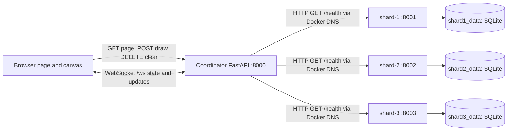

# Follow Along: Collaborative Pixel Canvas

This guide describes the repository as it exists today. It is a learning companion to the short [README](README.md), not a claim that every goal in the course proposal is already implemented.

## A. Project overview

The browser shows a 1000 by 1000 HTML canvas. A browser session can choose a colour and draw at a coordinate. Other browsers connected to the same coordinator see committed draw and clear messages over a WebSocket.

The project currently demonstrates several useful distributed-systems building blocks:

- **Identity and ownership:** the coordinator issues an opaque browser cookie and maps it to a server-side session ID. Every occupied coordinate stores its current colour and the session that last drew it.
- **Concurrent updates:** one `asyncio.Lock` serializes canvas reads, draws, clears, WebSocket registration, initial snapshots, and broadcasts inside the coordinator process.
- **Service separation:** Docker Compose describes a coordinator and three independently configured shard services, connected by a bridge network and DNS names.
- **Storage isolation:** each shard service has a distinct SQLite file in its own named Docker volume. Its sample record endpoints are infrastructure probes only.

The browser talks to the coordinator only. The coordinator serves the page, accepts drawing and clear HTTP requests, and sends live updates to browser WebSockets. At Phase 2, it contacts shard services only for `/health` probes. It does **not** route canvas pixels to shards. The coordinator still stores canvas pixels and sessions in process memory.

Docker containers simulate distinct processes and service identities on one physical computer. A Compose network gives each service a DNS name, and named volumes keep each shard database across container restarts. This is a useful local distributed-systems lab, but it is not a simulation of separate physical computers or networks with independent failures.

## B. Prerequisites and setup

### Known versions and prerequisites

- Windows 11 development environment.
- Python 3.11 or later is the documented minimum; the original development machine used Python 3.12.4.
- Docker Desktop for Windows using Linux containers and its WSL 2 backend; Docker Compose v2 is used by the commands below. Versions are not pinned in the repository.
- A modern browser and VS Code are useful.
- Package versions in `requirements.txt` are not pinned. Install them into a virtual environment for local Python work.

For official setup details, see [Microsoft's WSL installation guide](https://learn.microsoft.com/en-us/windows/wsl/install) and [Docker Desktop's WSL 2 backend instructions](https://docs.docker.com/desktop/features/wsl/).

### Windows 11: WSL 2 and Docker Desktop

In an elevated PowerShell terminal if Windows asks for administrator permission:

```powershell
wsl --install
wsl --update
wsl --status
```

Restart Windows if prompted. Install and start Docker Desktop. In Docker Desktop, select **Settings → General → Use the WSL 2 based engine**, then **Apply**. If you also use a Linux distribution terminal, enable it under **Settings → Resources → WSL Integration**. Docker Desktop can also be used from PowerShell without installing a separate Linux distribution. Confirm the engine is available:

```powershell
docker version
docker compose version
```

The application images use Linux containers. If Docker commands are not found, install/start Docker Desktop and reopen the terminal. If the CLI exists but reports a daemon error, wait for Docker Desktop's engine to start.

### Python environment for tests or local coordinator work

Run these commands from the project root, the directory containing `requirements.txt`:

```powershell
py --version
py -m venv .venv
.\.venv\Scripts\Activate.ps1
python -m pip install -r requirements.txt
```

If PowerShell blocks activation, invoke the virtual environment interpreter directly or use Command Prompt's `.venv\Scripts\activate.bat`. The dependency list currently includes FastAPI, Uvicorn, HTTPX, pytest, and pytest-asyncio.

### Start the Docker system

Still in the project root:

```powershell
Copy-Item .env.example .env
docker compose up --build
```

The coordinator is published on host port 8000:

- Canvas: <http://localhost:8000/>
- FastAPI docs: <http://localhost:8000/docs>
- Coordinator health: <http://localhost:8000/health>
- Live shard health overview: <http://localhost:8000/admin/shards>

The `.env` file sets `SHARD_URLS`. The coordinator uses entries such as `shard-1=http://shard-1:8001`; Docker DNS resolves those service names inside `canvas-net`. Shard ports are not published to Windows.

Useful lifecycle and inspection commands:

```powershell
docker compose ps
docker compose logs -f coordinator
docker compose logs -f shard-1
docker compose stop shard-2
docker compose start shard-2
docker compose restart shard-1
docker compose down
```

`docker compose down` keeps the three named data volumes. `docker compose down -v` deletes them and their records; reserve it for an intentional data reset. The test guide below does not delete volumes.

### Run tests

Local unit and API tests (the Docker integration test is skipped unless explicitly enabled):

```powershell
python -m pytest -q tests -p no:cacheprovider
```

Start the Compose services in one terminal. In another terminal, from the project root, run the real-container test:

```powershell
$env:RUN_DOCKER_INTEGRATION = "1"
python -m pytest -q tests/integration -p no:cacheprovider
Remove-Item Env:RUN_DOCKER_INTEGRATION
```

The integration test calls the host coordinator, runs HTTP requests inside actual shard containers with `docker compose exec`, inspects their mounted volume names, restarts shard-1, and checks that its record remains. It requires a running project. A skipped integration test is not evidence that Docker works.

## C. Architecture and data flow



### Browser to coordinator

1. `GET /` serves `frontend/index.html` and issues the `canvas_session` cookie if this browser has no registered session. The cookie is HTTP-only and SameSite=Lax; Secure is unset because the documented local service uses plain HTTP.
2. The browser opens `/ws` on the same host. The coordinator accepts only a token already present in its session registry.
3. The coordinator sends one initial `state` message. The page renders that message, then applies later `draw` and `clear` messages.
4. A pointer click posts `x`, `y`, and a HEX colour to `/draw`. The server gets the owner from the cookie, not from request JSON.
5. `DELETE /clear` removes only records currently owned by that session.

### Pixel ownership and synchronization

`pixels` is a dictionary keyed by strings like `"12,12"`. Each value is one object containing both `color` and `owner`. A successful draw replaces that object in one assignment, so a new colour is never paired with the old owner. The last draw that acquires `canvas_lock` wins that coordinate.

Draw and clear hold `canvas_lock` while changing the dictionary and broadcasting the resulting event. WebSocket registration and its snapshot use the same lock. Thus, within this single coordinator process, a new connection sees either a mutation in its initial snapshot or that mutation as a subsequent event. A concurrent clear and draw are serialized into one of two valid orders; the lock prevents a torn colour/owner update. This is not a distributed ordering guarantee across coordinator processes.

When Alice draws `(12,12)` red and Bob overwrites it green, the record becomes `{color: "#00FF00", owner: Bob's session}`. Alice's clear filters the current owner and leaves it. Bob's clear removes it.

### Coordinator to shards and SQLite

Compose places all four services on `canvas-net`. The coordinator checks configured URLs such as `http://shard-1:8001/health`; each shard checks its own SQLite connection and returns its configured ID and service version. `/admin/shards` makes the probes concurrently with short timeouts and returns per-shard health, including unavailable nodes.

Each shard writes only its own `infrastructure_records` table in `/data/shard.sqlite3`. `shard1_data`, `shard2_data`, and `shard3_data` are separate Docker-managed named volumes mounted at `/data`. These records demonstrate container storage boundaries and restart persistence. They are not canvas pixels, operation history, snapshots, or migration state.

## D. File-by-file guide

| File | Responsibility and relationships |
|---|---|
| `frontend/main.py` | Coordinator app, HTTP routes, cookie sessions, current pixel ownership, WebSocket manager, and live shard health probes. Serves `index.html`; imports HTTPX for shard probes. |
| `frontend/index.html` | Browser UI, Canvas drawing, HTTP draw/clear requests, WebSocket state/update rendering. |
| `shard/main.py` | Factory for the common shard FastAPI app, per-service identity/configuration, SQLite setup, health/info, and infrastructure record API. Compose starts this same module three times. |
| `shard/__init__.py` | Marks `shard` as an importable Python package for Uvicorn and tests. |
| `docker/coordinator.Dockerfile` | Builds the coordinator image with Python dependencies and `frontend/`; starts Uvicorn on port 8000. |
| `docker/shard.Dockerfile` | Builds the common shard image and starts Uvicorn on the environment-provided internal port. |
| `docker-compose.yml` | Defines coordinator, three shard services, health checks, restart policies, private bridge network, published coordinator port, and separate named volumes. |
| `.env.example` | Template for `SHARD_URLS`; copy to `.env`. |
| `.dockerignore` | Keeps local virtual environments, tests, caches, databases, and secrets out of image build contexts. |
| `.gitignore` | Excludes local environments, database files, cache output, and `.env` from normal version control. |
| `requirements.txt` | Runtime and test dependencies; versions are currently unpinned. |
| `pytest.ini` | Registers the `integration` pytest marker. |
| `tests/test_canvas.py` | Session, ownership/Clear, validation, WebSocket ordering, and lock interleaving regressions. |
| `tests/test_infrastructure.py` | Local shard API and mocked coordinator health/discovery tests. It does not start containers. |
| `tests/integration/test_docker_services.py` | Opt-in test that uses a live Compose project and real shard containers. |
| `README.md` | Short setup, command, and troubleshooting entry point linking here. |
| `ARCHITECTURE.md` | Concise system boundary, network, health, storage, and Phase 3 scope description. |
| `decision.md` | Chronological architecture decision records, including proposals not yet implemented. |
| `document.pdf`, `collab pixel doc.pdf` | Course proposal/reference documents describing intended future distributed behavior. Proposal content is not proof of implementation. |
| `frontend/__pycache__/*`, `tests/__pycache__/*` | Generated Python bytecode artifacts. They are not source-of-truth files and should not be hand-edited. |
| `.gitattributes` | Requests Git's standard text-file line-ending normalization. |

## E. Function-by-function guide

### `frontend/main.py`

**`ConnectionManager.__init__(self)`** initializes `active_connections`, the in-process list of connected WebSocket objects. It returns `None` and does not touch the canvas. `manager` is the one coordinator instance.

**`ConnectionManager.disconnect(self, websocket)`** removes the given socket if present. It returns `None`; it is idempotent for an already-removed socket. `websocket_endpoint` calls it in `finally`, and `broadcast` calls it after a failed send. It does not change pixel state.

**`ConnectionManager.broadcast(self, message)`** sends a JSON event to a copy of `active_connections`. It returns `None`; a failed send is logged and that connection is removed. Draw/clear call it while holding `canvas_lock`, so messages follow mutation order in this process. A slow socket can hold up other operations because sends are sequential and no send timeout is configured.

**`session_for(token)`** accepts a cookie token or `None`; it returns `(token, user_id)`. A registered token reuses its existing ID. Any missing/unknown token causes a random URL-safe token and UUID session ID to be generated and saved in the server dictionary. It never trusts an ID in a request body. The registry is in memory, has no expiration/authentication, and resets on coordinator restart.

**`public_pixels()`** takes no arguments and returns a new coordinate-to-colour dictionary, omitting owner metadata. `GET /state` and the WebSocket initial snapshot use it while holding `canvas_lock`; this keeps ownership private to server code.

**`configured_shards()`** takes no arguments and returns `list[tuple[shard_id, base_url]]`, parsed from comma-separated `SHARD_URLS` entries. If the variable is unset or blank, it uses the three Compose service-name defaults. Malformed entries raise `ValueError`; this is operator configuration, not user input. The coordinator health route calls it for each request, which is why a newly configured fixed shard can be discovered without a code change.

**`inspect_shard(shard_id, url)`** asynchronously performs one HTTP GET to `{url}/health` with the configured connect/read/write/pool timeouts. It returns a health dictionary. Matching ID and `healthy` status produce a healthy result with DB/version fields; network/HTTP/JSON failures return `unavailable`, and a valid but mismatched identity/status returns `unhealthy`. It logs HTTP-level failures and does not raise ordinary shard outage errors to the caller.

**`coordinator_health()` — `GET /health`** takes no arguments and returns a small coordinator status object. It has no state mutation or shard dependency; Docker uses it for the coordinator's container health check.

**`shard_health_overview()` — `GET /admin/shards`** takes no arguments and returns `{"shards": [...]}`. It gathers `inspect_shard` calls concurrently for each configured target. Each shard's failures are isolated in its own result. Bad `SHARD_URLS` syntax is not caught here and causes a server error, so keep the environment value valid.

**`home(request)` — `GET /`** reads the request cookie, calls `session_for`, serves the adjacent `index.html`, and sets `canvas_session` with `httponly=True` and `samesite="lax"`. It returns a `FileResponse`; it creates a session only when needed. The cookie is not Secure in this local HTTP setup.

**`get_state(request)` — `GET /state`** resolves/creates the browser session, acquires `canvas_lock`, copies public pixels, and returns JSON plus the session cookie. It does not mutate pixels. The current browser startup relies on the WebSocket snapshot rather than issuing a competing state fetch.

**`draw(request, http_request)` — `POST /draw`** validates `x`, `y`, and `color` through `DrawRequest`. Coordinates must be strict integers from 0 through 999; colour must match six-digit HEX. It gets the user ID from the cookie, uppercases the colour, then under `canvas_lock` atomically replaces `pixels["x,y"]` with `{color, owner}` and broadcasts a `draw` event. It returns a success JSON body and sets the cookie. The lock provides a single-process ordering point; there is no durable commit or shard write.

**`clear_my_pixels(request)` — `DELETE /clear`** obtains the owner from the server-validated session, then under `canvas_lock` selects and deletes only records whose current `owner` matches. It broadcasts their coordinate list, returns the number removed, and sets the cookie. A prior owner cannot delete a later owner's overwrite. Repeating clear is safe and returns zero when that user has nothing left.

**`websocket_endpoint(websocket)` — `WS /ws`** reads the cookie and rejects unregistered tokens with close code 1008. After accepting, it acquires `canvas_lock`, registers the connection, and sends a state snapshot before releasing the lock. It waits for client messages only to keep the socket open; drawing is HTTP-based. Disconnects and errors run cleanup in `finally`; unexpected errors are logged. This lock coupling prevents the snapshot/update race within one process.

**`DrawRequest`** is the Pydantic input model used by `/draw`. Its three fields validate bounds and HEX syntax before the route mutates shared state. It has no custom methods or side effects.

### `shard/main.py`

**`RecordRequest`** validates infrastructure write JSON: a nonempty key up to 200 characters and a value up to 4000 characters. FastAPI returns a validation response for invalid values; the model itself does no I/O.

**`create_app(shard_id=None, port=None, database_path=None)`** builds and returns one FastAPI app. Optional arguments support isolated tests; otherwise identity, port, DB path, and version come from environment defaults. It defines the nested DB helpers and route handlers below, then attaches them to this app instance. Each Compose container calls the same module but receives a different identity, port, and volume path.

**Nested `connect()`** takes no arguments and returns a configured `sqlite3.Connection`. It creates the parent directory, opens only this app's database with a five-second timeout, uses row objects, and sets SQLite's busy timeout.

**Nested `database_connection()`** is a context manager with no parameters. It opens one connection, commits/rolls back through the SQLite context, and always closes in `finally`. Shard endpoints use it so requests do not leak file handles.

**Nested `initialize_database()`** creates `infrastructure_records` if absent. It uses a parameterless `CREATE TABLE IF NOT EXISTS`; the primary key is the record key. It runs during application lifespan startup and does not delete existing records.

**Nested `lifespan(app)`** initializes the DB before serving and then yields control to FastAPI. It has no response body; a DB initialization failure prevents the service from starting healthy.

**`health()` — shard `GET /health`** opens the configured database and executes `SELECT 1`. It returns shard ID, healthy status, DB connection status, and service version; SQLite errors become HTTP 503. It does not write a test record.

**`info()` — shard `GET /info`** returns identity, configured port, DB path, service label, and version. It does not open or mutate the DB.

**`write_record(record)` — shard `POST /records`** performs a parameterized SQLite insert with conflict-update semantics inside a transaction, then reads and returns the stored row. The side effect is isolated to this shard's database. Reusing a key updates its value.

**`list_records()` — shard `GET /records`** returns all stored records ordered by key. It reads only and returns `{"records": [...]}`.

**`get_record(record_key)` — shard `GET /records/{record_key}`** parameterizes the lookup. It returns the row or raises HTTP 404 if absent; it never creates data.

The module-level **`app = create_app()`** is the object Uvicorn imports in each shard container. The factory's default local DB path is under `shard/data`; Compose overrides it to `/data/shard.sqlite3` inside each named volume.

### `frontend/index.html`

**`paint(x, y, color)`** fills a small visible 3 by 3 rectangle at the logical coordinate. It returns nothing and only changes the local canvas pixels.

The anonymous **WebSocket `open` callback** updates the status text after the connection opens; it receives the browser event and does not change server state.

The **WebSocket `message` callback** parses event JSON. For `state`, it paints the canvas white and redraws each returned coordinate. For `draw`, it calls `paint` with the event's coordinate and colour. For `clear`, it paints the listed coordinates white. Its parameter is the browser message event; its side effect is UI rendering only.

The **WebSocket `close` callback** changes status to disconnected. The **`error` callback** reports a connection error. Both receive browser events and do not retry automatically.

The **canvas `pointerdown` callback** maps pointer position within the displayed canvas to integer coordinates in the 1000×1000 logical grid, reads the selected colour, and posts JSON to `/draw`. It updates status on success and reports fetch/HTTP failure. The server remains authoritative; the callback does not locally paint the requested pixel.

The **Clear button `click` callback** sends `DELETE /clear`, checks HTTP success, reads the `cleared` count, and updates status. It doesn't blank the whole canvas itself; the server broadcast carries exact removed coordinates to all connected pages.

The constants and event handlers together ensure the browser connects to the same host as the page, selecting `ws:` or `wss:` based on the page scheme.

### `tests/test_canvas.py`

Each `test_*()` function below takes no explicit arguments except where a fixture is named, returns no application value (`None`), and establishes behavior through assertions. FastAPI TestClient calls may mutate the module-level app state, which `reset_memory_state()` clears before the next test. The inner `scenario()` coroutines take no arguments and return no value; they exist to coordinate deterministic async events.

**`reset_memory_state()`** is an autouse pytest fixture. Before each test, it clears coordinator pixels, sessions, connections, and replaces the async lock. It yields to the test and has no teardown logic. This prevents process-global state leaking between cases.

**`test_different_sessions_draw_and_clear_only_their_current_pixels()`** uses separate TestClients as users A and B. It checks the requested `(12,12)` red-to-green overwrite, A's clear preserving B's green pixel, then B's clear removing it. It returns no value; failures identify ownership regressions.

**`test_clear_removes_unoverwritten_pixels_and_repeated_clear_is_a_noop()`** draws two coordinates in one session, confirms one clear removes both, and confirms a second clear returns zero. It covers ordinary ownership deletion and idempotent repeated requests.

**`test_clear_only_removes_its_owner_when_users_have_distinct_pixels()`** gives Alice two pixels and Bob one, then verifies Alice's clear leaves Bob's pixel and Bob can clear it.

**`test_draw_validates_canvas_coordinates_and_hex_color()`** submits out-of-range, fractional, boolean, and invalid HEX values. It asserts HTTP 422 and ensures malformed inputs cannot enter the canvas.

**`test_session_cookie_is_secure_for_local_http_and_survives_refresh()`** verifies the HTTP-only and SameSite=Lax attributes, the deliberate absence of Secure for local HTTP, and reuse of the registered cookie/session after refresh.

**`test_two_browser_sessions_have_distinct_server_generated_ids()`** creates two clients and checks their mapped session IDs differ and are not the raw cookie tokens. It then submits a forged `user_id` in Alice's draw body and verifies the pixel is still owned by Alice's cookie session.

**`test_websocket_requires_a_server_registered_session()`** attempts a socket without first creating a session. It expects a disconnect rather than an accepted unauthenticated socket.

**`test_websocket_snapshot_and_broadcast_order_across_clear_and_draw()`** draws before connect, verifies that draw is in the initial snapshot, then checks clear and a later draw arrive in order.

**`test_disconnected_websocket_is_removed_from_connection_manager()`** opens and closes a socket and asserts the connection list is empty afterward.

**`test_draw_waits_until_websocket_initial_snapshot_is_sent()`** contains an inner `scenario()` coroutine and a fake socket that pauses the initial send. It starts a draw while the snapshot lock is held, verifies the draw waits, releases the snapshot, and checks state then draw event order and cleanup. The outer test runs the coroutine with `asyncio.run`.

Its fake **`PausingWebSocket.accept()`** takes no arguments beyond `self`, returns `None`, and stands in for ASGI's handshake without network I/O. **`send_json(message)`** sets an event and waits only when sending the initial `state`; then it records the JSON message. **`receive_text()`** waits until the scenario allows disconnect and raises `WebSocketDisconnect`, exercising endpoint cleanup. These are test doubles for ASGI methods; they do not open a network connection.

**`test_concurrent_clear_waits_for_inflight_draw_broadcast_and_leaves_consistent_state()`** contains an inner coroutine and pausing fake WebSocket. It stalls a draw broadcast while the canvas lock is held, starts a clear, and verifies clear waits. After release, draw then clear are broadcast, and the final pixel dictionary is empty. This establishes serialization for this in-process interleaving; it is not a load or multi-process stress test.

Its fake socket's **`send_json(message)`** appends each event and pauses after the draw event until the test releases its gate. It lets the test hold the actual application lock across the draw broadcast so a clear request can be shown waiting behind it.

**`test_websocket_receives_state_and_committed_draw_update()`** checks the empty initial state and normalized draw event on a live TestClient WebSocket.

### `tests/test_infrastructure.py`

The test functions return no value; they use temporary SQLite files or a TestClient. The two tests with a `monkeypatch` parameter use pytest's fixture to override environment/probe behavior and restore it after the test.

**`test_shard_health_reports_identity_database_and_version()`** builds an app against a temporary test DB, starts its lifespan with TestClient, and checks health and configured port. It removes its test DB afterward.

**`test_shard_records_are_transactional_and_databases_are_isolated()`** starts two factory-created shard apps with distinct DB paths, writes a key to shard one, reads it there, and expects 404 from shard two. It cleans both DB files.

**`test_coordinator_reports_live_shard_checks_and_unavailable_shards(monkeypatch)`** sets three service URLs and replaces `inspect_shard` with an async fake for this unit test. It verifies one unavailable result does not fail `/admin/shards`. It does **not** demonstrate Docker DNS.

Its nested **`fake_inspect(shard_id, url)`** returns a healthy result for shard one and three and a timeout-style unavailable result for shard two. It accepts the same identifiers as the production probe and has no network effects.

**`test_coordinator_shard_registry_can_include_a_configured_fourth_shard(monkeypatch)`** adds a fourth URL to the environment and confirms parsing returns the new service target. It does not create the container.

### `tests/integration/test_docker_services.py`

Module setup skips the test unless `RUN_DOCKER_INTEGRATION=1` and the Docker CLI is present. The test assumes the Compose project is already running.

**`request_json(url, method="GET", payload=None)`** issues a standard-library HTTP request and returns `(status_code, decoded_json)`. It catches HTTPError so the expected 404 isolation result can be asserted rather than hidden.

**`compose(*args, check=True)`** runs `docker compose` from the repository root and returns a captured `CompletedProcess`. It raises on failed commands by default.

**`call_container_shard(shard, port, path, method="GET", payload=None)`** builds a small Python urllib script and runs it with `docker compose exec -T` inside the requested shard container. It is used because shard ports are private and not published to the host.

**`volume_name(shard)`** gets the running container ID and uses `docker inspect` to return the Docker volume mounted at `/data`.

**`test_compose_shards_use_isolated_volumes_and_keep_records_after_restart()`** checks the live coordinator health overview, expected unique shard IDs and service URLs, and three different named volume names. It writes a random record into shard one, confirms shard two returns 404 for that key, restarts shard one, waits for all health probes to recover, and verifies shard one's record is still present.

### `docker/`, `docker-compose.yml`, and configuration

`coordinator.Dockerfile` copies `frontend/`, installs `requirements.txt`, and starts `frontend.main:app` on 8000. `shard.Dockerfile` copies the one `shard/` package and starts it on the environment port. The Compose health-check commands use Python's standard-library urllib; no curl package is required. Compose's only host port mapping is `8000:8000` for the coordinator.

`.env.example` supplies the three `SHARD_URLS`; `SHARD_ID`, `PORT`, and `SHARD_DB_PATH` differ per shard service. The dedicated `canvas-net` network supplies DNS names. The top-level volume names are distinct. `requirements.txt` serves both images and local tests, so test packages are also installed in the images in this version.

## F. Reproducible demonstrations

### Two users, overwrite, and Clear

1. Open <http://localhost:8000/> in a normal browser window and a private/incognito window. Separate windows in the same browser profile share cookies, so use distinct profiles for distinct sessions.
2. In the first window draw at `(12,12)` in red. In the second window draw at the same location in green. Both pages should show green after the WebSocket event.
3. Click **Clear my pixels** in the first window. Its response says it cleared zero owned pixels if that was Alice's only pixel; `(12,12)` stays green.
4. Click **Clear my pixels** in the second window. The green pixel disappears from both pages.

The red-to-green behavior is automated in `test_different_sessions_draw_and_clear_only_their_current_pixels`.

### Shard discovery and health

With Compose running, use a browser or PowerShell:

```powershell
Invoke-RestMethod http://localhost:8000/admin/shards | ConvertTo-Json -Depth 5
docker compose ps
```

Expect one `healthy` entry per configured shard, with IDs `shard-1`, `shard-2`, `shard-3`. Stop one shard with `docker compose stop shard-2`; the coordinator should still answer and report shard two unavailable. Restart it with `docker compose start shard-2` and wait for health to return.

### Verify storage isolation and restart persistence

Use the PowerShell write/restart/read commands in the [README verification section](README.md#verify-health-and-persistence), then run the opt-in integration test in section B. Each record is written to the shard's own database. The integration test also asserts the Docker volume names differ.

## G. Troubleshooting

- **Docker engine not running:** open Docker Desktop, wait for the engine, then check `docker version` and `docker compose version`.
- **WSL problem:** use `wsl --status`, `wsl --update`, and `wsl --list --verbose`; restart if the install/update prompts for it. Confirm Docker Desktop has the WSL 2 engine enabled. The [Microsoft guide](https://learn.microsoft.com/en-us/windows/wsl/install) and [Docker WSL guide](https://docs.docker.com/desktop/features/wsl/) cover current setup steps.
- **Port 8000 conflict:** change the host side of Compose mapping from `8000:8000`, for example to `8001:8000`, and browse `http://localhost:8001/`.
- **Container unhealthy:** inspect `docker compose ps` and `docker compose logs <service>`. A shard DB permission/path error prevents shard health from succeeding.
- **Shard discovery fails:** inspect `.env` and confirm each entry is `id=http://compose-service-name:port`. Inter-container URLs use Compose DNS names, not host localhost. `/admin/shards` is a live probe, not a static inventory.
- **Python dependency errors:** activate `.venv` and rerun `python -m pip install -r requirements.txt`.
- **Docker integration test fails:** make sure Compose is running, the coordinator is on the configured `COORDINATOR_URL` (default `http://127.0.0.1:8000`), and each shard is healthy. The test restarts shard-1 but does not remove volumes.
- **Data missing after stopping:** `docker compose down` preserves volumes; `docker compose down -v` deletes them. Check the command used before assuming a recovery defect.

## H. Implemented versus future work

| Capability | Current state |
|---|---|
| Shared browser canvas and WebSocket draw/clear updates | Implemented in the coordinator process; local API tests cover key flows. |
| Server-issued HTTP-only session cookie | Implemented; session map is in coordinator memory, not durable authentication. |
| Current pixel owner and owner-specific clear | Implemented; overwrite ownership and concurrent draw/clear lock behavior are regression-tested. |
| Coordinator and three independently configured shard containers | Compose/Dockerfiles are written. Actual startup has not been verified in this environment when Docker is unavailable. |
| Shard health/info and SQLite infrastructure records | Implemented and covered by local app tests. Live Docker behavior is covered by an opt-in test that must be run against containers. |
| Separate named volumes and persistence across restart | Configured; persistence is not considered proven until the real-container test passes. |
| Tile mapping/routing and only-assigned-tile storage | Planned; not implemented. |
| Ownership epochs, per-tile positions, durable drawing-operation deduplication | Planned; not implemented. |
| Live tile migration, migration recovery, shard crash recovery | Planned; not implemented. |
| Undo, coordinated multi-shard clear, snapshots, hashes, timelapse | Planned; not implemented. |
| Multiple coordinator replicas or cross-process WebSocket broadcast | Not implemented. The coordinator is a single point of failure. |

## Documentation maintenance rules for future phases

For every future feature change:

1. Update `FOLLOW_ALONG.md` with affected files and functions.
2. Update function explanations if a signature, behavior, parameter, return value, or side effect changes.
3. Update `ARCHITECTURE.md` when service boundaries, data flow, storage, or system behavior changes.
4. Append an ADR to `decision.md` for each significant architecture decision. Do not silently rewrite the decision history.
5. Update `README.md` if setup, commands, endpoints, or user-visible behavior changes.
6. Add or adjust tests and explain exactly what each test establishes.
7. Clearly label features as implemented, tested, partial, or planned.
8. Never describe behavior the code does not implement.
9. Preserve old decisions; mark them superseded or deprecated rather than deleting them.
10. Explain concepts in plain language suitable for a student learning distributed systems.
